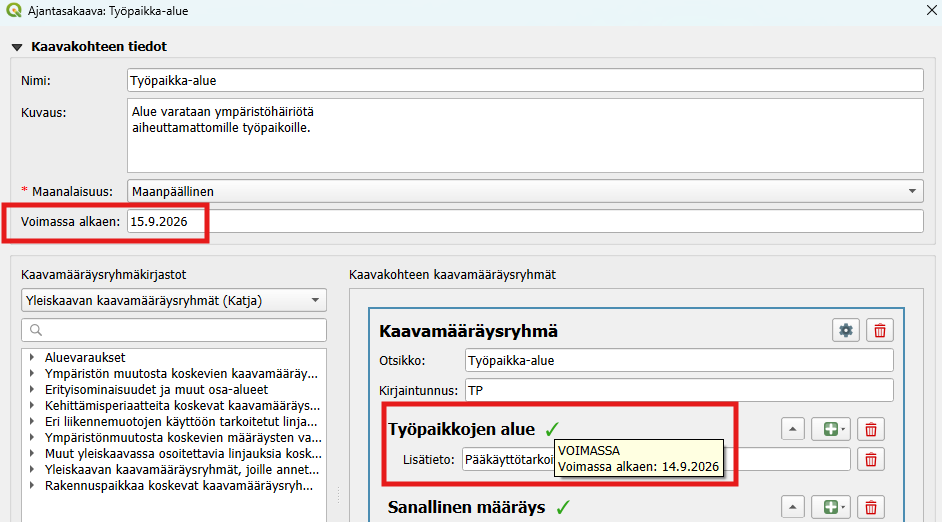

# Ajantasakaava – kaavayhdistelmä

Arho luo Arhon tietokantaan tallennetuista voimassa olevista kaavoista ajantasakaavan. Tämä ajantasakaava on mukana Arhon kaavoitusprojektissa. Se tulee näkyviin, kun kaava-asia on auki. Kaava-asian kaavalaji määrittää, näytetäänkö asema-, yleis- vai maakuntakaavan ajantasakaava.

Ajantasakaavan kaavakohteiden tietoja voi tarkastella { .icon width="26" } -työkalulla. Lomake näyttää päivämäärän, jolloin kohteen voimassaolo on alkanut. Lisäksi kaavamääräysten perässä voimassaoloa kuvaavan symbolin vihjeteksti kertoo voimassaolopäivämäärän.

Arhon ajantasakaavaa tarvitaan kaavan kumoamistietojen luomiseen. Kunnalla voi lisäksi olla toisessa järjestelmässä eri tavalla ylläpidetty ajantasakaava tai kaavayhdistelmä.
