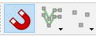
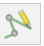
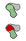
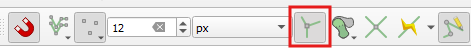
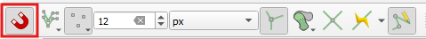

# Liite: QGISin digitoinnin, seuraamisen ja tarttumisen asetukset

Alla olevassa taulukossa on suositukset QGISin asetuksista, kun digitoit Arholla.

| Mitä digitoidaan? | Tarttuminen { .icon } { .icon } | Topologinen editointi { .icon } | Päällekkäisyys { .icon } | Seuraaminen { .icon } |
|---|---|---|---|---|
| **Kaavan ulkoraja** | Laita tarttuminen päälle, jos haluat, että kaavan ulkoraja rajautuu tarkasti muihin tietokannan kaavan ulkorajoihin. | Ota topologinen editointi pois päältä. Jos topologinen editointi on päällä ja kaavasi ulkoraja rajautuu toiseen kaavan ulkorajaan, tulet muokanneeksi molempia ulkorajoja muokatessasi toista, mikä tuskin on tarkoituksenmukaista. | Salli päällekkäisyys, jos kaavan ulkoraja saa mennä päällekkäin toisen kanssa. Vältä, jos ei saa. | Aseta päälle, jos kaavasi ulkorajan tulee rajautua tarkasti viereiseen kaavan ulkorajaan. |
| **Aluevaraus** | Laita tarttuminen päälle. Suositeltavaa asettaa tarttuminen aktiiviseen tasoon ja pisteisiin. Tämä auttaa muodostamaan yhtenäisen pohjan aluevarauksista. | Kun kahdella alueella on yhteinen raja ja topologinen editointi on päällä, yhteisen rajan muokkaus muokkaa molempia alueita. Tämä auttaa säilyttämään yhtenäisen kaavapohjan. Vaarana viereisen alueen vahinkomuokkaukset, joten ole tarkkana. | Aseta **Vältä päällekkäisyyttä** päälle. Aluevaraukset eivät saa olla päällekkäin, ja tämä asetus estää sen. | Aseta päälle, niin aluevarauksesi rajautuu muihin aluevarauksiin ja kaavan ulkorajaan. Voit hyödyntää myös muita aineistoja, joita käytät apuna. |
| **Osa-alue** | Hyödynnä, jos käytät osa-alueen piirtämisessä apuna muita (vektori)aineistoja. | Pidä päällä, jos haluat, että kohteet, joilla on yhteisiä verteksejä tai segmenttejä, tulevat muokatuiksi samalla kertaa. | Salli päällekkäisyys. Jos **Vältä päällekkäisyyttä** on päällä, et pysty piirtämään osa-alueita muiden alueiden päälle. | Hyödynnä, jos käytät osa-alueen piirtämisessä apuna muita (vektori)aineistoja. |
| **Viiva** | Aseta tarttuminen päälle, jos hyödynnät toista aineistoa. Jos haluat, että viiva tarttuu alueen rajaan pisteiden väliltä, valitse tarttuminen segmenttiin. | Pidä päällä, jos haluat, että kohteet, joilla on yhteisiä verteksejä tai segmenttejä, tulevat muokatuiksi samalla kertaa. | | Aseta päälle, jos haluat viivan seuraavan toista viivaa tai aluetta. Asettamalla offset-arvon viiva seuraa toista viivaa tai aluetta tietyn etäisyyden päästä. |
| **Piste** | Aseta tarttuminen päälle, jos hyödynnät toista aineistoa ja on tärkeää, että piste osuu oikeaan kohtaan. | | | |

Lisäksi suositellaan käytettäväksi topologista muokkausta päällä aina, paitsi silloin kun ei nimenomaan haluta, että viereiset kohteet liikkuvat. Kun tämä vaihtoehto on käytössä, QGIS havaitsee yhteiset rajat. Kun siirrät yhteisiä verteksejä tai segmenttejä, QGIS siirtää niitä myös naapurikohteiden geometrioissa, ja näin vältytään päällekkäisiltä aluevarauksilta tai raoilta aluevarausten välissä.

Lisäksi suositellaan käytettäväksi tarttumista viivoihin ja vertekseihin. Jos tarttuu viivaan ja topologinen editointi on päällä, piirrettävään kohteeseen muodostuu toisen kohteen verteksi.

Lisää QGISin editointi- ja digitointityökalujen ominaisuuksista voi lukea [QGISin käyttöohjeesta](https://docs.qgis.org/3.40/en/docs/user_manual/working_with_vector/editing_geometry_attributes.html#editing).
