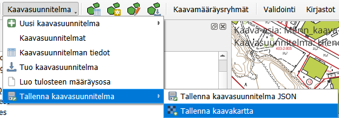
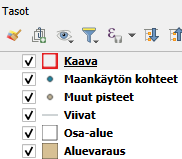

# Tallenna kaavakartta (GeoTIFF)

**Tallenna kaavakartta** -toiminnolla saat tallennettua aktiivisesta kaavasta GeoTIFFin.

Toiminto vie kuvaan kaikki ne tasot, jotka on valittuna tasolistalla.

1.  Valitse **Tasot**-listalta tasot, jotka haluat viedä GeoTIFFiin. Kaikki ne tasot, joiden edessä on ✓, tulevat kuvaan näkyville.

    

2.  **Kaavasuunnitelma**-valikon alta löydät **Tallenna kaavakartta** -toiminnon, jota klikkaamalla pääset määrittämään tiedostopolun, johon haluat tallentaa kaavakartan.
