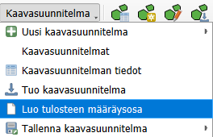
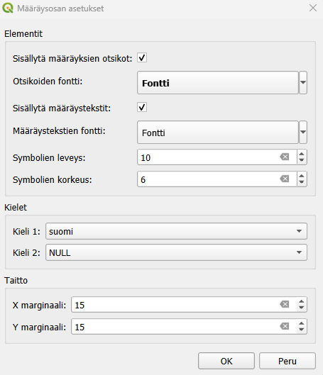

# Määräysosa

Määräysosa listaa kaavasuunnitelman määräykset ja niiden kuvaustekniikan kartalla. Arhossa toiminto löytyy **Kaavasuunnitelma**-valikon alta:

Käyttäjällä on mahdollisuus säätää määräysosan fonttia, symbolien kokoa, kieliä ja marginaaleja.

{ width="393" }

Arhon tuottama määräysosa ei ole asettelultaan joustava, joten sen jatkokäsittely kuvankäsittelyohjelmassa saattaa olla tarpeen.
