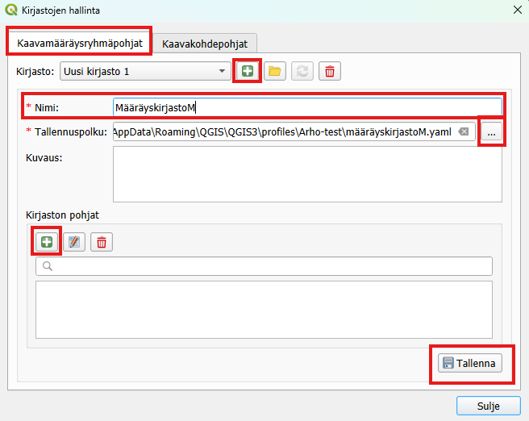
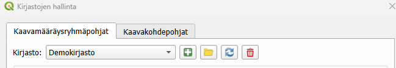
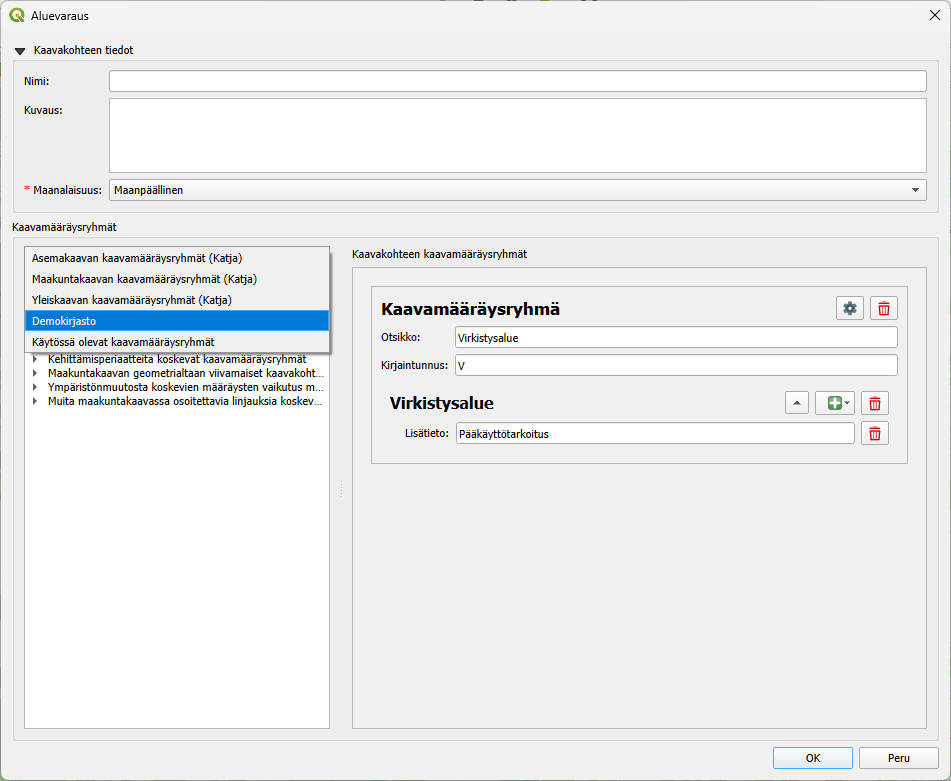
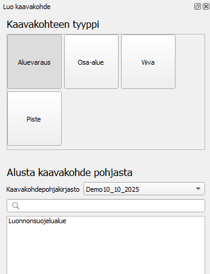

# Kirjastot

Kirjasto on kokoelma kaavamääräysryhmien tai kaavakohteiden luomiseen tehtyjä pohjia. Käyttäjän on mahdollista luoda kirjastoja ja lisätä niihin mallipohjia helpottamaan työskentelyä. Pohjista voi luoda uusia kaavamääräysryhmiä tai kaavakohteita kaavamääräysryhmineen. Kirjastot pitävät siis sisällään eräänlaisia reseptejä tai mallipiirroksia kaavamääräysryhmien ja kaavakohteiden luomiseen. Kirjaston voi myös jakaa YAML-tiedostona toiselle käyttäjälle. Kirjastot helpottavat työskentelyä, kun kaavamääräysryhmiä ja kaavakohteita linkittyvine kaavamääräysryhmineen ei tarvitse joka kerta laatia alusta asti.

Kirjastoja hallitaan Arhon **Kirjastot**-painikkeesta, josta avautuu **Kirjastojen hallinta**.

## Kaavamääräysryhmäkirjastot

Arho sisältää valmiina kirjastot Katjan mukaisista kaavamääräysryhmistä.

Omien kaavamääräysryhmäkirjastojen hallinta tapahtuu ***Kirjastot***-painikkeen takaa aukeavassa **Kirjastojen hallinta** -ikkunassa.

### Kirjaston luominen

1.  Valitse välilehti ***Kaavamääräysryhmäpohjat***.
2.  Luo uusi kirjasto auenneessa ikkunassa painamalla ylimpänä olevaa { .icon } -painiketta.
3.  Anna kirjastolle nimi.
4.  Määritä kirjastolle tallennuspolku kolmen pisteen { .icon } kautta.
5.  Muodosta ja lisää kirjastoon haluamasi kaavamääräysryhmät { .icon } -painikkeella. Aukeava lomake on hyvin samanlainen kuin kaavamääräysryhmien luomisessa.
6.  Paina lopuksi **Tallenna**.

{ width="549" }

### Kirjaston muokkaaminen

1.  Avaa **Kirjastojen hallinta** **Kirjastot**-painikkeesta.
2.  Valitse kirjasto, jota haluat muokata, ja tee muutokset.

{ width="503" }

### Kirjaston käyttäminen

1.  Tallennettu kirjasto tulee näkyville kaavamääräysryhmäkirjastoihin.

    

2.  Voit käyttää omaa kirjastoasi liittääksesi kaavakohteille kaavamääräysryhmiä.

## Kaavakohdepohjakirjasto { #plan-object-templates }

Kaavakohdepohja on joukko kaavamääräysryhmiä. Käyttämällä kaavakohdepohjaa voit piirtää kohteen geometrian, ja kohteelle liitettävät kaavamääräysryhmät (niitä voi olla useita) tulevat suoraan pohjasta.

### Kirjaston luominen ja muokkaaminen

Kaavakohdepohjakirjastoja hallitaan samalla tavalla kuin kaavamääräysryhmäkirjastojakin.

1.  Avaa **Kirjastojen hallinta** painamalla **Kirjastot**-painiketta.

2.  Valitse välilehti ***Kaavakohdepohjat***.

3.  Anna kirjastolle nimi.

4.  Luo uusi kaavakohdepohjakirjasto auenneessa ikkunassa painamalla ylimpänä olevaa { .icon } -painiketta.

5.  Määritä kirjastolle tallennuspolku kolmen pisteen { .icon } kautta.

6.  Lisää uusi pohja kirjastoon { .icon } -painikkeella.

    1.  Valitse geometriataso, jolle kaavakohdepohja laaditaan.
    2.  Muodosta kaavamääräysryhmä.
    3.  Paina **Tallenna kaavakohdepohjakirjastoon**.
    4.  Paina **OK**, kun olet valmis.

7.  Paina lopuksi **Tallenna** ja sulje.

### Kaavakohdepohjien käyttäminen

1.  Kaavakohdepohjat saa käyttöön QGISin paneelista ***Luo kaavakohde***.
2.  Valitse ensin kaavakohteen geometriatyyppi ***Kaavakohteiden tyypit*** -kohdan alta.
3.  Valitse ***Alusta kaavakohde pohjasta*** -kohdasta sopiva mallipohja ja digitoi kohde.

