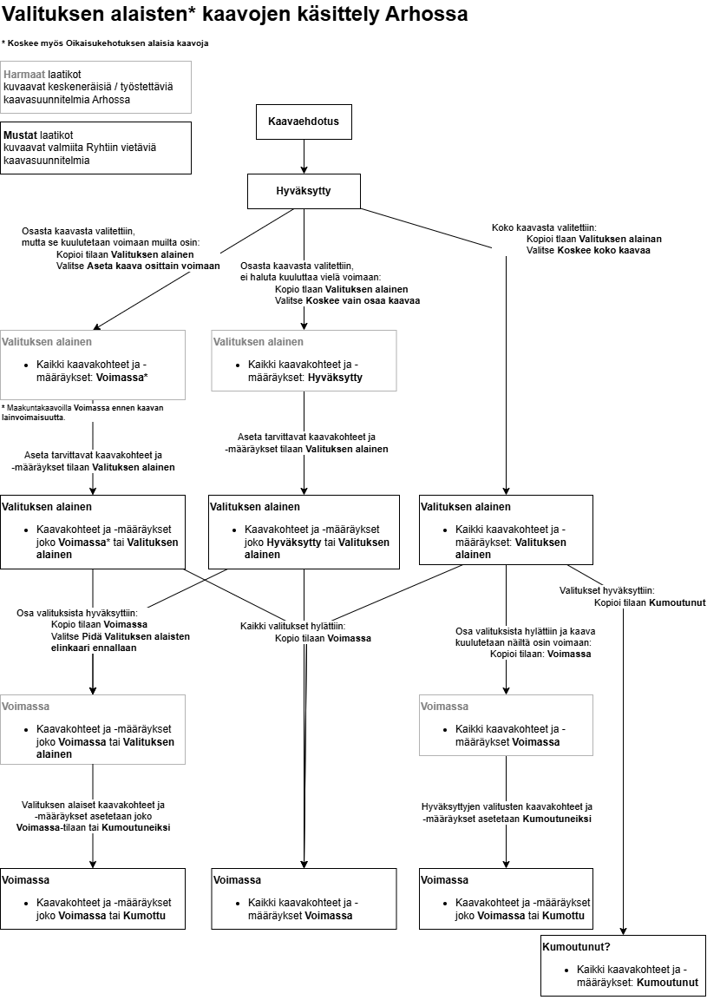
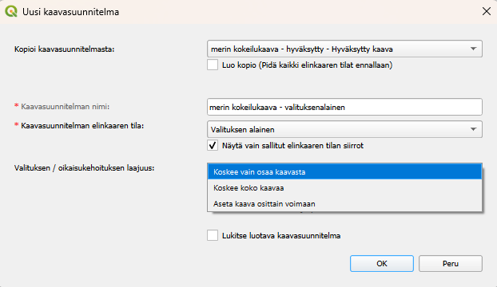
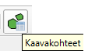
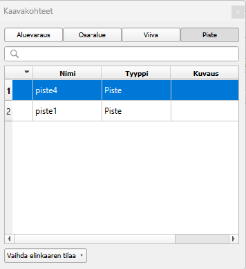
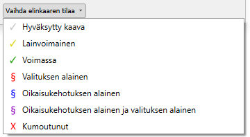
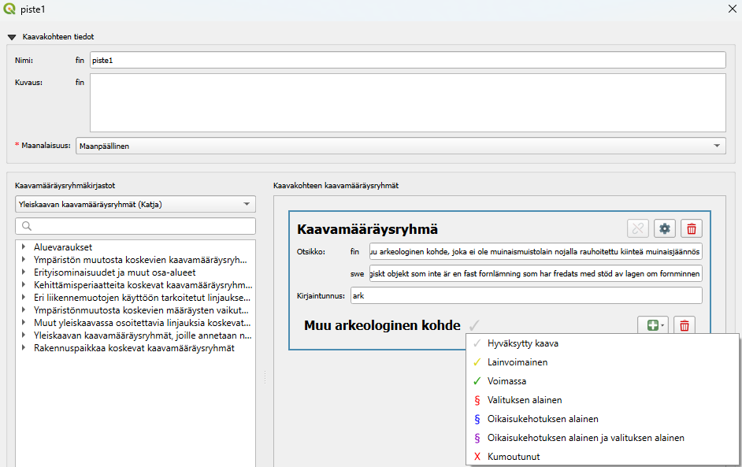
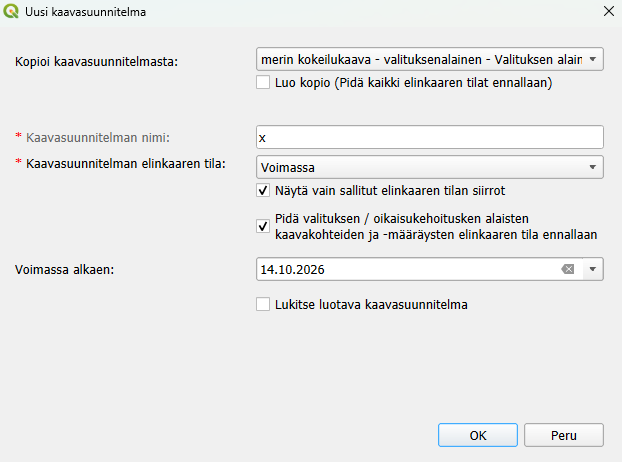

# Valituksenalainen ja oikaisukehotuksen alainen

Jos kaavasta tehdään valitus, voi valitus koskea koko kaavaa tai tiettyjä kaavakohteita ja -määräyksiä. Arholla nämä on mahdollista merkitä omaan kaavasuunnitelmaan, jonka elinkaaren vaihe on valituksenalainen. Seuraavat vaiheet riippuvat siitä, mikä on valitusten käsittelyn lopputulos. Kaikki, mikä koskee valituksenalaista, koskee myös oikaisukehotuksen alaista ja valituksen- ja oikaisukehotuksen alaista. Tätä kokonaisuutta on havainnollistettu alla olevassa kuvassa.

Kun hyväksytystä kaavasta tehdään valitus, luo uusi kaavasuunnitelma hyväksytystä ja valitse elinkaaren tilaksi *valituksenalainen*.

Samalla määritetään, koskeeko valitus / oikaisukehotus koko kaavaa vai vain osaa kaavasta.

- **Koskee koko kaavaa**: Kaikki kaavasuunnitelman kaavakohteet, -määräykset ja -suositukset asetetaan elinkaaren tilaan **Valituksenalainen**.
- **Koskee vain osaa kaavasta**: Kaavasuunnitelman kaavakohteet, -määräykset ja -suositukset jätetään elinkaaren tilaan **Hyväksytty kaava**. Käyttäjä avaa kaavasuunnitelman ja päivittää itse tarvittavien kohteiden elinkaaren tilan.
- **Aseta kaava osittain voimaan**: Käyttäjä antaa voimassaolon alkamispäivämäärän (huomioi, että voimassaolon alkamispäivämäärän tulee olla vasta hyväksymispäivämäärän jälkeen). Kaavasuunnitelman kaavakohteet, -määräykset ja -suositukset asetetaan elinkaaren tilaan **Voimassa**. Käyttäjä avaa kaavasuunnitelman ja päivittää tarvittavien kohteiden elinkaaren tilan.

Kun kaavan elinkaaren tila on valituksenalainen, tulee sen kaikkien kaavamääräysten ja kaavakohteiden elinkaaren tilan olla **Valituksenalainen** tai **Voimassa**.

## Kaavakohteen elinkaaren tilan muuttaminen { #plan-object-status }

Avaa kaavasuunnitelma, jonka tilaksi on asetettu valituksenalainen, oikaisukehotuksen alainen tai valituksen- ja oikaisukehotuksen alainen.

1.  Avaa [kaavakohdepaneeli](../plan-objects.md#panel) Arhon työkalupalkista.

    

2.  Valitse listasta siniseksi kohteet, joiden elinkaaren tilaa haluat muuttaa.

    

3.  Paneelin alareunassa on työkalu **Vaihda elinkaaren tilaa**. Valitse sieltä, mihin elinkaaren tilaan haluat vaihtaa valittuna olevat kohteet.

    

4.  Kaavakohteiden listaukseen ilmestyy symboli.

## Kaavamääräyksen elinkaaren tilan muuttaminen

Kokonaisen kohteen sijaan valitus ja/tai oikaisukehotus voidaan kohdistaa vain kohteeseen liittyvään määräykseen.

1.  Kaavamääräystä pääset muokkaamaan kahdella tavalla:

    - Avaa kaavakohteen tiedot (kaksoisklikkaa kohdetta kaavakohdepaneelissa tai valitse kohde kartalta **Muokkaa kaavakohteita** -työkalulla).
    - Avaa kaavamääräysryhmän tiedot **Kaavamääräysryhmät**-paneelista kaksoisklikkaamalla ja mene **Kaavamääräykset**-välilehdelle.

2.  Määräyksen perässä näet symbolin, joka kertoo sen elinkaaren tilasta. Harmaa väkänen kertoo voimassa olevasta kaavasta. Klikkaa sitä, ja voit vaihtaa kyseisen määräyksen elinkaaren tilan.

    

Kun kaikki kaavakohteet ja -määräykset, joihin liittyy valituksia, on merkitty, kaavasuunnitelma kannattaa lukita.

## Valitusten ratkaisun vieminen Arhoon ja kaavan asettaminen voimaan { #appeal-decision }

Kaavasta tehdyt valitukset tulevat joko hyväksytyiksi tai hylätyiksi, jolloin tämä tieto pitää viedä myös kaavasuunnitelmaan: läpi menneet valitukset kumoavat kaavan, kaavakohteita tai -määräyksiä, ja kaikki muu astuu voimaan (vrt. kuva sivun alussa).

Luo uusi kaavasuunnitelma olemassa olevasta:

1.  Valitse, minkä suunnitelman pohjalta teet lainvoimaisen / voimassa olevan kaavan.

2.  Valitse elinkaaren tilaksi **Voimassa** ja merkitse voimaantulon päivämäärä.

3.  Valitse, pidetäänkö valituksen / oikaisukehotuksen alaisten kaavakohteiden elinkaaren tila ennallaan.

    - Jos tässä kohdassa ei ole valintaa, Arho muuttaa kaikille kohteille ja määräyksille elinkaaren tilaksi **Lainvoimainen / Voimassa**.
    - Jos tässä on valinta, valituksen tai oikaisukehotuksen alaisiksi asetettujen kaavakohteiden ja -määräysten elinkaaren tila pysyy sellaisena, ja muut kaavakohteet ja määräykset asetetaan lainvoimaisiksi / voimassa oleviksi.

    { width="464" }

4.  Luo suunnitelma.

5.  Nyt voit käydä muuttamassa kohteiden ja määräysten elinkaaren tilaa, esimerkiksi kumota valituksenalaiset kohteet (katso [Kaavakohteen elinkaaren tilan muuttaminen](#plan-object-status)).

6.  Muutosten jälkeen aseta kaava lopulliseksi (kuten kohdassa [Voimassa: voimaan asettaminen ja liittäminen ajantasakaavaan](in-force.md)).
