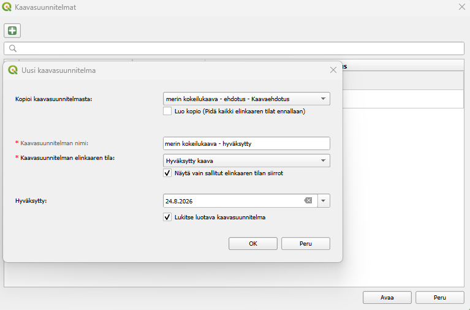

# Hyväksytty kaava

Kun kaavaehdotus on hyväksytty, luodaan ehdotuksesta hyväksytty kaava kaavasuunnitelmat-listauksen plus-nappulan kautta. Hyväksytty kaava edellyttää hyväksymispäivämäärän antamista. Hyväksyttyä kaavaa ei pääsääntöisesti muokata, joten sen voi lukita heti luomisen yhteydessä.

