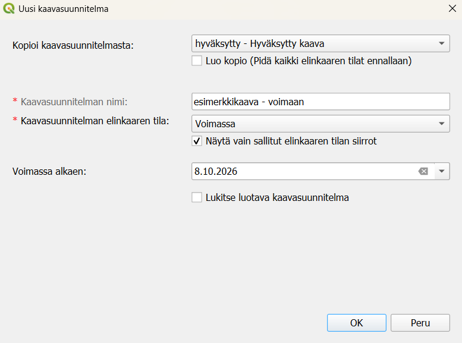
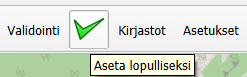
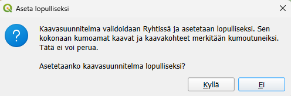

# Voimassa: voimaan asettaminen ja liittäminen ajantasakaavaan

Kaava merkitään Arhossa lainvoimaiseksi ja voimassa olevaksi luomalla jälleen uusi kaavasuunnitelma **Kaavasuunnitelmat**-ikkunan vihreästä plus-nappulasta.

1.  Valitse, minkä suunnitelman pohjalta teet lainvoimaisen / voimassa olevan kaavan.

    Jos voimaan asetetaan valituksen / oikaisukehotuksen alainen kaava, pitää tässä vaiheessa kertoa, miten valitettujen kohteiden kanssa toimitaan. Katso tarkemmin [Valitusten ratkaisun vieminen Arhoon ja kaavan asettaminen voimaan](appeal.md#appeal-decision).

2.  Asetettaessa kaava voimaan tulee antaa voimassaolon alkamispäivämäärä.

3.  Luotavan voimassa olevan kaavasuunnitelman voi lukita tässä vaiheessa, sillä sitä ei ole tarkoitus enää muokata.

4.  Kun voimassa oleva kaavasuunnitelma on luotu, viimeinen vaihe on asettaa kaava lopulliseksi.

    1.  Näkyviin on tullut **Aseta lopulliseksi** -työkalu Arhon työkalupalkissa.

        

    2.  Toimenpidettä ei voi perua, ja Arho varoittaa tästä.

        { width="376" }

        Kaava ja sen kaavakohteet määräyksineen liitetään osaksi voimassa olevaa [ajantasakaavaa](../consolidated-plan.md) Arhon tietokannassa voimaantulopäivänään.
