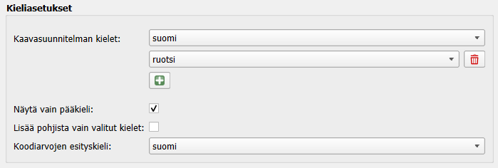
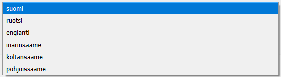
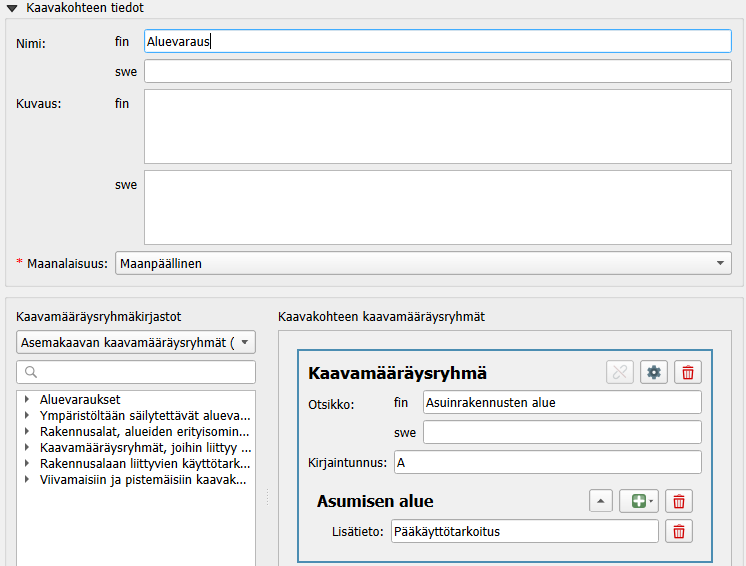

# Monikielinen kaava

Arho mahdollistaa monikielisen kaavan tekemisen. Arhon asetuksista käyttäjä voi asettaa kaavan pääkielen ja muut kielet.

Kieliä lisätään vihreästä plussasta ja poistetaan punaisesta roskakorista. Valittavana on Ryhdin tukemat kuusi kieltä.

Kun kaavalla on enemmän kuin yksi kieli, kentät, joihin syötetään tekstiä, saavat lisää kenttiä, mikä mahdollistaa tiedon syöttämisen eri kielillä samaan aikaan.

Jos tarkoituksena on kuitenkin laatia kaava ensin yhdellä kielellä ja kääntää vasta lopuksi, voi olla helpompaa piilottaa muiden kielten kentät. Tämä tehdään asetuksista valinnalla **Näytä vain pääkieli**.

Kentät, jotka tulevat koodistoista, eivät saa eri kielille lisäkenttiä, sillä niiden erikieliset arvot saadaan suoraan koodistoista. Asetuksista *Koodiarvojen esityskieli* määrittää, millä kielellä arvot näkyvät käyttöliittymässä.
