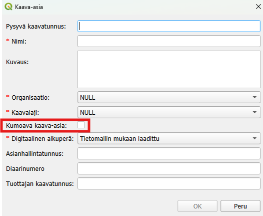

# Kaavamuutos

Arhon tämänhetkisessä versiossa kaavamuutos on toiminto, jolla uusi voimaan astuva kaava kumoaa altaan kaiken sen ulkorajan sisälle jäävän aiemman kaavatiedon.

Kun tällaista kumoavaa kaavaa lähdetään Arhossa tekemään, tulee kaava-asiaa luodessa merkitä kaava kumoavaksi kaavaksi. Näin Arho tietää, että pitää luoda kumoamistiedot kohteille, jotka kaava tulee kumoamaan astuessaan voimaan.

{ width="363" }

Laadi kaava kuten muutenkin ja aseta se voimaan. Arho tuottaa kumoamistiedot kumoutuvista kohteista ja päivittää ajantasakaavaa / kaavayhdistelmää vastaavalla tavalla.

## Kumoamistiedot

Arho luo kumoamistietoja vain, jos kaava-asian tiedoissa on ruksittu **Kumoava kaava-asia**. Kumoamistiedot liitetään JSON-vientiin. Käyttäjä voi varmistua kumoamistietojen syntymisestä avaamalla kumoamistietojen ominaisuustietotaulukon. Kumoamistiedot eivät varsinaisesti ole ihmisluettavia, mutta ne näkyvät taulussa riveinä.
