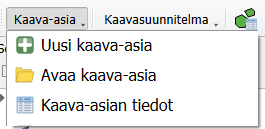
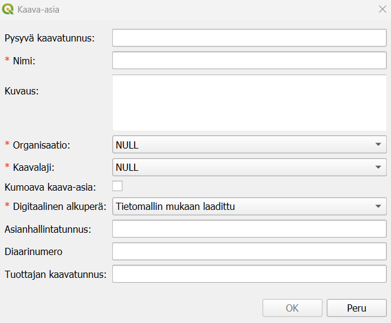
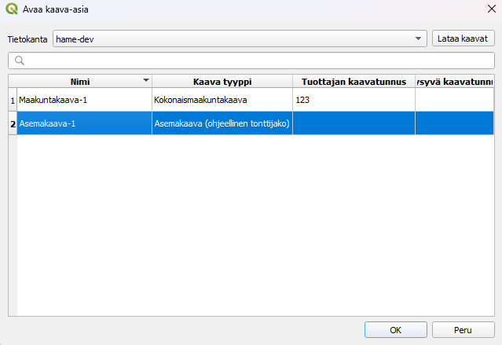

# Kaava-asia

Kaava-asioiden hallintaa varten lisäosaan on lisätty kolme toimintoa.

## Uuden kaava-asian luonti

Uuden kaava-asian voi lisätä seuraavasti:

1.  Aloita klikkaamalla **Uusi kaava-asia** -nappia.

2.  Täytä auenneen lomakkeen tiedot. Vaaditut tietueet on merkitty punaisella tähdellä \*.

    { width="584" }

3.  Lopuksi paina **OK**. Tällöin uusi kaava-asia tallennetaan kantaan ja se asetetaan aktiiviseksi. ***Aikaisemmin mahdollisesti aktiiviseksi asetettu kaavasuunnitelma deaktivoituu.***

## Aktiivisen kaava-asian muokkaus

1.  Aktiiviseksi asetettua kaava-asiaa pääsee muokkaamaan **Muokkaa kaava-asiaa** -napista. Tämä avaa saman lomakkeen kuin uuden kaava-asian luonnissa.

2.  Täydennä puuttuvat tiedot tai muokkaa jo tallennettuja tietoja auenneen lomakkeen kautta.

3.  Paina **OK**, jolloin muokkaukset tallentuvat. Kaava-asian muokkaus ei deaktivoi aktiivista kaavaa.

## Kaava-asian avaus / vaihto

Lisäosa mahdollistaa vain yhden kaava-asian aktivoinnin kerrallaan. Kaava-asian avaus onnistuu **Avaa kaava-asia** -nappia klikkaamalla.

1.  Tämä avaa ikkunan, jossa näkyviin tulevat kaikki tallennetut kaava-asiat.

    { width="589" }

2.  Valitse listalta kaava-asia, jonka haluat aktivoida. Valittu kaava-asia korostetaan sinisellä värillä, kuten yllä olevassa kuvassa.

3.  Lopuksi paina **OK**, jolloin valitsemasi kaava-asia asettuu aktiiviseksi ja ***kaavasuunnitelma deaktivoituu***.

## Kaava-asian poistaminen

Kaava-asian poistaminen on varattu vain admin-käyttäjälle. Jos sinulla on admin-oikeudet organisaatiosi Arho-toteutukseen, pääset poistamaan kaava-asian avaamalla kaava-asia-taulun, valitsemalla haluamasi kaava-asian rivin ja painamalla **Delete**.
