# Kaavakohteet

## Kaavakohteiden piirtäminen

1.  Aloita kaavakohteen luominen valitsemalla **Luo kaavakohde**. Valitse painikkeista kaavakohteen tyyppi sen mukaan, minkä kohteen haluat piirtää.

    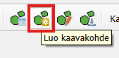 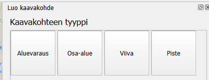{ width="297" }

2.  Kun olet valinnut kaavakohteen tyypin, voit piirtää kohteen kartalle hiirellä klikkailemalla.

3.  Katso vinkkejä QGISin digitoinnin, tarttumisen ja seuraamisen asetuksista liitteestä [QGISin digitoinnin, seuraamisen ja tarttumisen asetukset](digitizing.md).

## Kaavamääräyksen liittäminen kaavakohteelle

Kun kaavakohde on piirretty, avautuu ikkuna, jossa pääset liittämään kohteelle kaavamääräyksiä. Valitse kohteelle sopivat kaavamääräysryhmät ja kaavamääräykset ***kaksoisklikkaamalla*** sopivaa kaavamääräysryhmäkirjaston alla olevaa kaavamääräysryhmää. Huomaa, että voit valita, mitä kirjastoa kulloinkin haluat käyttää (asema-, yleis- tai maakuntakaavan kirjasto, käytössä olevat tai itse luotu kirjasto). Hakukentän avulla voit etsiä sopivaa kaavamääräysryhmää sanahaun avulla.

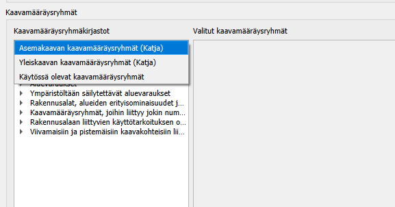{ width="438" }

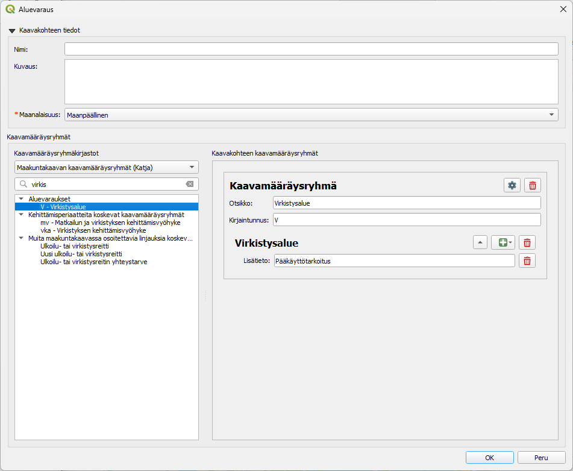

Voit etsiä sopivia ryhmiä hakutoiminnolla. Kun oikea kaavamääräysryhmä löytyy, ***kaksoisklikkaa kohdetta***, jotta se tulee valituksi. Tee tarvittavat muokkaukset.

- 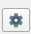{ .icon } Rattaasta pääsee muokkaamaan kaavamääräysryhmän tietoja, kaavamääräystä tai -määräyksiä ja kaavasuosituksia (katso [Kaavamääräysryhmän luominen ja muokkaaminen](regulation-groups.md#create-edit)).
- 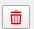{ .icon } Roskakori poistaa kaavamääräysryhmän.
- 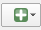{ .icon } Plussasta saa määritettyä aihetunnisteen, kaavoitusteeman ja lisätiedon.

    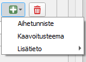

- Mikäli valitsit sanallisen määräyksen, syötä **Arvo**-kenttään määräyksen sanallinen kuvaus ja valitse määräykselle sopiva sanallisen määräyksen laji.

    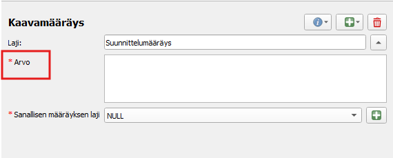

Paina lopuksi **OK**.

## Olemassa olevan kaavakohteen muokkaus ja poistaminen

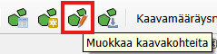

1.  Jos haluat muokata olemassa olevia kaavakohteita, valitse **Muokkaa kaavakohteita**.

    1.  Jos haluat muokata kohteen tietoja, klikkaa hiirellä kohdetta, ja sen lomake aukeaa.

    2.  Jos haluat muokata kohteen geometriaa, valitse esimerkiksi QGISin taitepistetyökalu tai joku digitoinnin lisätyökaluista, ja muokkaa haluamaasi kohdetta.

2.  Jos haluat poistaa kaavakohteen, valitse kohde kartalta ja paina **Delete** tai poista kohde ominaisuustietotaulun kautta.

## Kaavakohdepaneeli { #panel }

**Kaavakohteet**-työkalusta 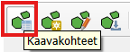{ .icon } aukeaa kaavakohdepaneeli.

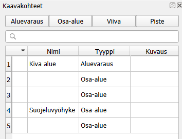

Tästä taulukkonäkymästä näet kaikki kaavasuunnitelmassasi olevat kaavakohteet. Koska kohteita voi olla paljon, voi olla kätevää suodattaa niitä tyypin mukaan tai etsiä hakusanalla.

Voit käyttää kaavakohdepaneelia kaavakohteiden valitsemiseen. Kun valitset rivin paneelissa, kohde tulee valituksi myös kartalla ja toisinpäin.

Klikkaamalla kohteen riviä hiiren oikealla painikkeella saat käyttöön neljä (tai viisi) toimintoa.

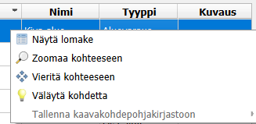

- **Näytä lomake** avaa kaavakohteen lomakkeen. Lomakkeen saa auki myös tuplaklikkaamalla riviä. Lomakkeella voit muokata kohteen tietoja.
- **Zoomaa kohteeseen** lähentää karttanäkymän valitsemaasi kohteeseen.
- **Vieritä kohteeseen** pitää mittakaavan samana ja keskittää kartan valitsemaasi kohteeseen.
- **Väläytä kohdetta** korostaa kohdetta tilapäisesti, jotta löydät sen kartalta.
- **Tallenna kaavakohdepohjakirjastoon** on käytettävissä, jos olet luonut kaavakohdepohjakirjaston (katso [Kaavakohdepohjakirjasto](libraries.md#plan-object-templates)).

## Tuo kaavakohteita

Arho mahdollistaa kohteiden tuomisen muista aineistoista **Tuo kaavakohteita** -työkalulla.

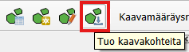

Valitse työkalu, ja eteesi aukeaa **Tuo kaavakohteita** -ikkuna.

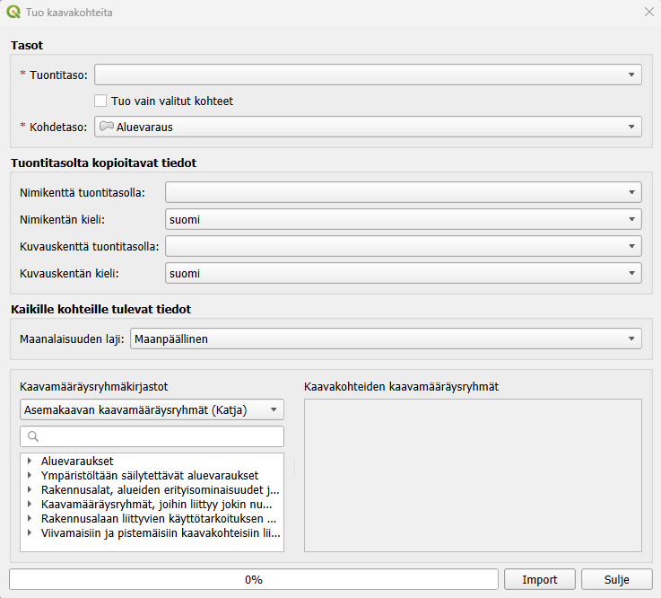

### Tasot

Pakolliset kentät ovat ***tuontitaso*** ja ***kohdetaso***. Tuontitaso on se vektoritaso, jolta haluat tuoda kaavakohteita. Huomaa, että voit valita tuoda vain valitut kohteet, voit siis valita haluamaltasi tasolta kohteet, jotka haluat tuoda. Kohdetaso on se Arhon kaavakohdetaso, jolle kohteet halutaan tuoda, ja riippuu siis tuotavan kaavakohteen tyypistä. Tuontitason ja kohdetason geometriatyyppien täytyy olla samat.

### Tuontitasolta kopioitavat tiedot

Kaavatietomallin monimutkaisuuden vuoksi Arhoon voi tuoda pääasiassa kohteiden geometrioita. Mahdollisia tuotavia tietoja ovat nimi ja kuvaus. Tuontitasolta kopioitavissa tiedoissa voi määrittää, mistä tuontitason kentistä nämä tiedot löytyvät ja millä kielellä tiedot ovat.

### Kaikille kohteille tulevat tiedot

Viimeisenä voit määrittää tietoja, jotka liitetään kaikkiin tuomiisi kohteisiin: kohteiden maanalaisuuden lajin ja annettavat kaavamääräysryhmät. Koska kaavakohteiden maanalaisuuden täytyy olla määriteltynä Ryhdissä, maanalaisuuden laji -valintaa ei voi jättää tyhjäksi, ja sen valinta on oletuksena **Maanpäällinen**.

Kaavamääräysten liittämiseksi tuotaville kohteille ikkunaan on tuotu käytettäväksi kaavamääräysryhmäkirjastot. Käyttäjä voi näistä valita tuplaklikkaamalla, mitä kaavamääräysryhmiä tahtoo kohteille liittää. Kaavamääräysryhmiä ei ole pakko liittää tässä vaiheessa.

!!! note "Huomaa"

    Sekä maanalaisuuden laji että kaavamääräysryhmät liitetään kaikille tuotaville kohteille riippumatta mistään tuontitason ominaisuustiedosta. Kaavakohteita täytyy siis käytännössä tuoda sellaisissa erissä, joille tulee samat kaavamääräysryhmät, mikäli haluaa asettaa kaavamääräysryhmät jo tuontivaiheessa eikä myöhemmin.

Kun asetukset on valittu, painamalla **Import**-nappia saa aloitettua tuomisprosessin.
