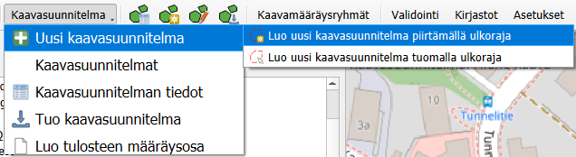
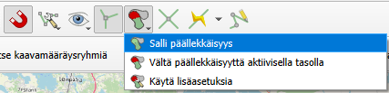
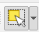
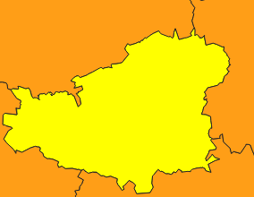
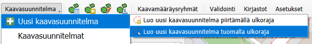
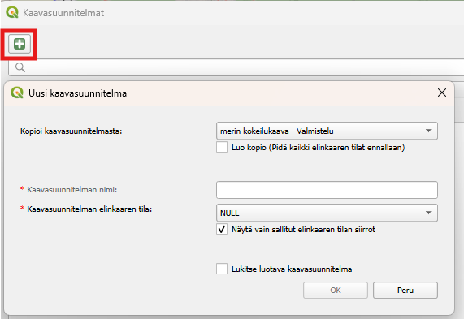
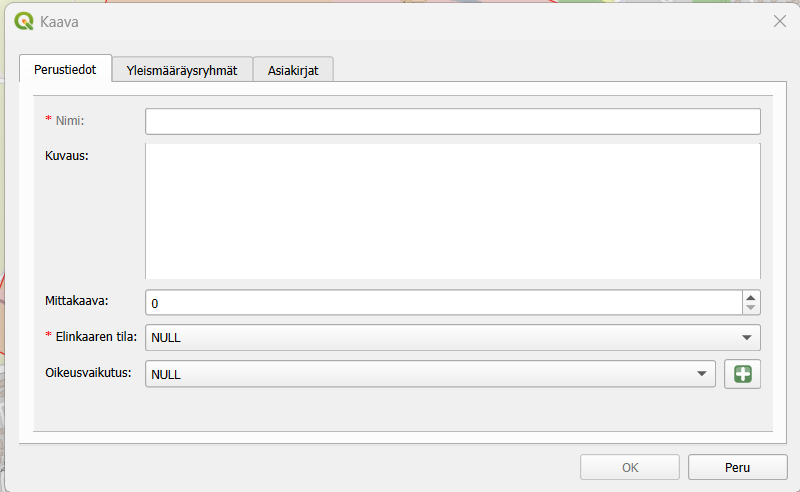
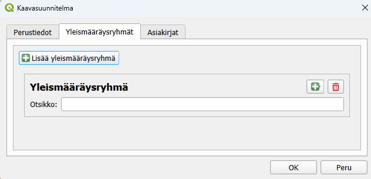
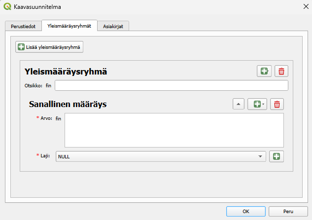

# Uuden kaavasuunnitelman luonti

Kun kaava-asialle luodaan ensimmäinen kaavasuunnitelma, käytetään Arhon työkalua **Uusi kaavasuunnitelma**.

Kaavasuunnitelman luominen aloitetaan antamalla sille ulkoraja. Tämä voidaan tehdä joko piirtämällä eli digitoimalla, tuomalla ulkoraja toiselta tasolta tai tiedostosta, tai käyttämällä aktiivisen kaavasuunnitelman kaavarajaa.

## Kaavasuunnitelman ulkoraja

### Kaavasuunnitelman ulkorajan piirtäminen

1.  Aloita uuden kaavan tekeminen valitsemalla **Uusi kaavasuunnitelma > Luo uusi kaavasuunnitelma piirtämällä ulkoraja**.

    

2.  Kun piirrät uuden ulkorajan, karttaikkunaan tulevat näkyviin tietokannassa olevat muiden kaavasuunnitelmien ulkorajat, jotta näihin voi tarvittaessa tarttua.

3.  Digitoi kaavasuunnitelman ulkoraja hiiren vasenta painiketta käyttäen ja päätä digitointi hiiren oikealla painikkeella.

    !!! warning "Huom."

        Älä käytä QGISin perinteistä digitointia, vaan aloita digitointi aina käynnistämällä lisäosan **Luo uusi kaavasuunnitelma** tai **Luo kaavakohde**.

4.  Täytä auenneen lomakkeen tiedot. Pakolliset kentät on merkitty punaisella tähdellä \*. Harmaa väri viittaa tietoon, joka ei siirry Ryhtiin. Paina lopuksi **OK**.

!!! tip "Vinkki"

    Katso QGISin seuraamisen ja tarttumisen asetuksia liitteestä [QGISin digitoinnin, seuraamisen ja tarttumisen asetukset](../digitizing.md).

### Kaavasuunnitelman ulkorajan tuominen

1.  Ennen kuin aloitat kaavasuunnitelman ulkorajan tuontia, tarkista QGISin tarttumisen ja topologiatyökalujen asetukset. Jos on mahdollista, että uusi raja voi mennä päällekkäin kartalla jo olevien kohteiden kanssa, varmista, että et ole kieltänyt topologiatyökaluissa kohteiden päällekkäisyyttä.

    

2.  Kun topologia-asetukset ovat kunnossa, aloita kaavasuunnitelman ulkorajan tuonti valitsemalla QGIS-projektin joltain tasolta kohde, jonka haluat tuoda kaavan ulkorajaksi. Esim. maakuntatasolta valitaan QGISin valintatyökalulla { .icon } yksi maakunta aktiiviseksi.

    

3.  Seuraavaksi valitse **Uusi kaava > Tuo kaavan ulkoraja**. Täytä auenneeseen lomakkeeseen tarvittavat tiedot kaavasta.

    

4.  ***Varmista ennen tuontia, että tuotavan tason koordinaatisto on sama kuin projektilla (useimmiten EPSG:3067).***

## Uusi kaavasuunnitelma olemassa olevasta suunnitelmasta { #from-existing }

***Tätä toimintoa on mahdollista käyttää vain, jos kaava-asialle on jo luotu vähintään yksi kaavasuunnitelma.***

1.  Avaa **Kaavasuunnitelmat** ja paina ikkunan vasemmassa yläkulmassa olevaa { .icon } -merkkiä.

    

2.  Valitse pudotusvalikosta, mistä suunnitelmasta haluat luoda uuden version. Valitse samalla, haluatko vain kopion aiemmasta, vai oletko siirtämässä kaavaa ja sen kohteita uuteen elinkaaren vaiheeseen.

3.  Syötä uudelle kaavasuunnitelmalle nimi. Kaavasuunnitelman nimi on käytössä vain Arhossa eikä sitä toimiteta Ryhtiin, joten voit nimetä sen haluamallasi tavalla. Käytännössä nimestä on hyvä pystyä erottamaan, mistä suunnitelmasta on kyse.

4.  Anna kaavasuunnitelmalle elinkaaren tila. Valintaa helpottamaan voit asettaa näkyviin vain ne elinkaaren tilat, joihin kyseisen kaavasuunnitelman saa Ryhdin määräysten mukaan. Elinkaaren vaiheista Arhossa lisää osiossa [Elinkaaren vaiheet](../lifecycle/index.md).

5.  Halutessasi voit lukita uuden suunnitelman saman tien, esimerkiksi tilanteessa, jossa muutat hyväksytyn kaavan voimassa olevaksi.

6.  Paina **OK**, jolloin uusi kaavasuunnitelma luodaan, mutta sitä ei aseteta aktiiviseksi.

7.  Jos haluat asettaa luodun kaavasuunnitelman aktiiviseksi, valitse juuri luotu kaavasuunnitelma listalta ja paina **Avaa**.

## Kaavasuunnitelman tiedot

### Perustiedot

Kun kaavasuunnitelmalla on ulkoraja, aukeaa ikkuna, johon syötetään kaavasuunnitelman tiedot. Pääset kaavasuunnitelman lomakkeelle myös **Kaavasuunnitelma**-valikosta kohdasta **Kaavasuunnitelman tiedot** tai tuplaklikkaamalla suunnitelman riviä **Kaavasuunnitelmat**-ikkunassa.

Kaavasuunnitelman nimi näkyy Arhossa kaavasuunnitelmat-listauksessa ja se on Arhon käytön kannalta pakollinen tieto, mutta sitä ei viedä Ryhtiin. Kaavasuunnitelman nimeksi kannattaa antaa oman organisaation nimeämiskäytänteiden mukainen nimi, joka on sisäisessä käytössä kuvaava.

### Yleismääräykset

Yleismääräykset annetaan omalla välilehdellään. Lisää ensin yleismääräysryhmä.

Lisää sitten yleismääräysryhmään määräyksiä ja suosituksia. Anna määräyksille arvo ja valitse oikea sanallisen määräyksen laji. Tarvittaessa voit lisätä määräykselle useamman lajin.

### Asiakirjat

Arho mahdollistaa kaavaan liittyvien asiakirjojen tietojen tallentamisen. Tällä hetkellä Arhoa ei kuitenkaan kehitetä siihen suuntaan, että sen avulla hallittaisiin asiakirjoja, joten tätä osiota ei ole tarpeen käyttää.
