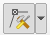
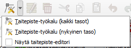
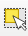
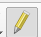
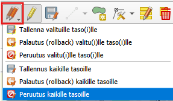

# Olemassa olevan kaavasuunnitelman muokkaus ja poistaminen

1.  Jos haluat päästä tarkastelemaan jo luotuja kaavoja, valitse **Kaavasuunnitelma > Kaavasuunnitelmat** ja valitse listalta haluamasi kaava.

2.  Jos haluat muokata olemassa olevan kaavasuunnitelman tietoja, valitse **Kaavasuunnitelman tiedot** tai tuplaklikkaa haluamasi kaavasuunnitelman riviä **Kaavasuunnitelmat**-ikkunassa. Huom. jos kaava on hyväksytty, et voi enää muokata sitä.

3.  Jos haluat muokata kaavasuunnitelman ulkorajaa, hyödynnä QGISin digitointityökaluja. Taitepisteiden siirto onnistuu digitointityökalujen **Taitepiste**-työkalulla { .icon }. Huomaa, että voit valita, mille tasolle työkalun toiminnot kohdistuvat.

    

4.  Kaavasuunnitelmia ja kaava-asioita voi **poistaa** ainoastaan henkilö, jolla on tietokannassa admin-käyttöoikeudet. Kun haluat poistaa kaavasuunnitelman:

    1.  Poista ensin kaikki suunnitelmassa olevat kaavakohteet.

    2.  Valitse kaavasuunnitelma **Tasot**-paneelista aktiiviseksi, valitse kaavan ulkoraja aktiiviseksi kartalta valintatyökalulla { .icon } ja paina **Delete**. Muista varmistaa, että taso on muokattavissa eli editointi on päällä { .icon }.

    3.  Mikäli kaavan tai kaavakohteen poistossa ilmenee tallennus- tai poistamisongelmia, valitse digitointityökaluista kuvake ***Nykyiset muokkaukset*** ja sopiva vaihtoehto, esim. **Peruutus kaikille tasoille**. Tämä toimenpide palauttaa projektin lähtötilanteeseen ennen edellistä muokkausta.

        
