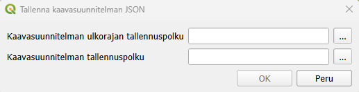

# Tallenna kaavasuunnitelma (vienti JSON-muotoon)

Kaavan ulkorajan ja koko kaavasuunnitelman saa tallennettua JSON-muotoon **Tallenna kaavasuunnitelma JSON** -toiminnolla.

Ohjelma tallentaa samalla kertaa sekä kaavasuunnitelman ulkorajan että itse kaavasuunnitelman. Valitse kolmen pisteen takaa tiedostopolut, joihin haluat tallentaa JSON-tiedostot.

JSON-tiedoston avulla voit viedä kaavatiedot Ryhti-järjestelmään lomakekäyttöliittymän kautta (ryhti-palvelut.syke.fi).
