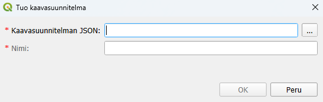

# Tuo kaavasuunnitelma

**Tuo kaavasuunnitelma** -toiminnolla voidaan tuoda Arhon tietokantaan Ryhti-muotoinen JSON-tiedosto, esimerkiksi Arhosta otettu varmuuskopio tai jostain muusta kaavoitusohjelmistosta ladattu JSON-tiedosto. Työkalu korvaa aiemman version tuotavasta kaavasuunnitelmasta, joten työkalulla ei voi tehdä samasta kaavasuunnitelmasta kopioita tietokantaan.

1.  Valitse **Kaavan JSON** -kenttään tiedosto, jonka haluat tuoda.
2.  Anna kaavasuunnitelmalle nimi (tätä nimeä ei viedä Ryhtiin).
3.  Paina lopuksi **OK**.

{ width="456" }
