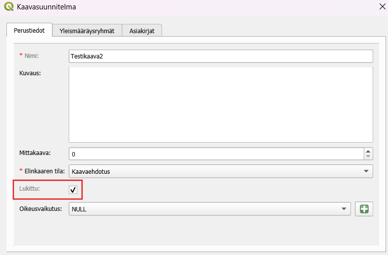
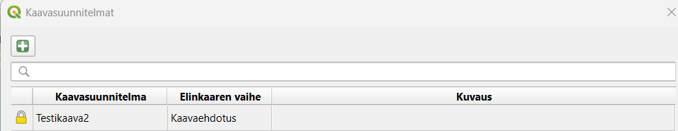

# Kaavasuunnitelman lukitseminen

Kun työn alla oleva kaavasuunnitelma tulee valmiiksi, eikä sitä saa enää muuttaa, voi kaavasuunnitelman lukita.

Avaa kaavasuunnitelman tiedot (**Kaavasuunnitelma > Kaavasuunnitelman tiedot**, tai tuplaklikkaamalla kaavasuunnitelmat-listauksesta haluamaasi suunnitelmaa), ruksi kohta **Lukittu** ja paina **OK**.

Lukittu kaavasuunnitelma näkyy kaavasuunnitelmat-listauksessa lukkokuvakkeen kanssa.

Lukitun kaavasuunnitelman tietoja voi tarkastella, mutta sitä ei voi muokata.
