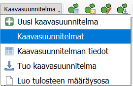

# Kaavasuunnitelman avaus / vaihto

1.  Aloita painamalla **Kaavasuunnitelma**-valikosta **Kaavasuunnitelmat**.

    

2.  Valitse listalta kaavasuunnitelma, jonka haluat avata.

    

    - Aktiivisen kaavasuunnitelman edessä on vihreä pallo.
    - Rivin alussa oleva lukko kertoo, onko kaavasuunnitelma lukittu muutoksilta vai muokattavissa.

3.  Paina **Avaa**, jolloin valittu kaavasuunnitelma asetetaan aktiiviseksi.
