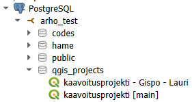
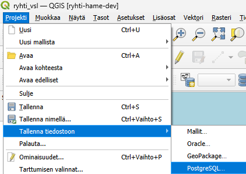
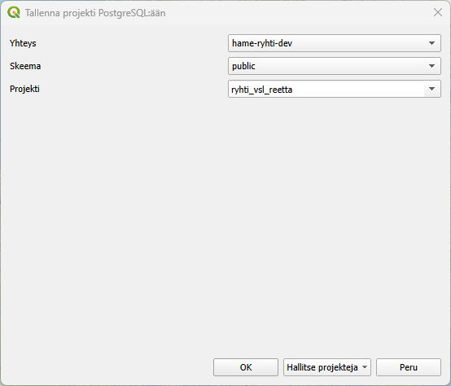
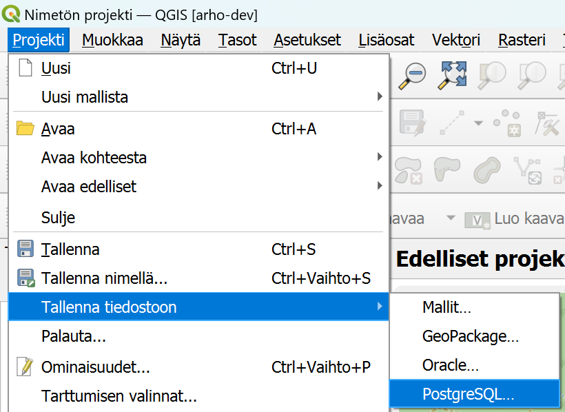
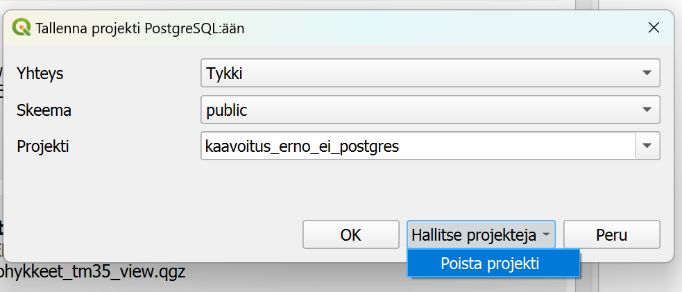

# Kaavoitusprojekti QGISissä

QGIS toimii projekteilla. Aina kun jotain on auki ja tehdään, on auki myös projektitiedosto. Arhon käyttöä varten on laadittu oma ***kaavoitus***-niminen projekti, joka sisältää mm. käytön kannalta oleellisia karttatasoja. Tämä projektitiedosto on oleellinen osa Arho-kokonaisuutta ja toiminnallisuuksia, ilman sitä Arho ei toimi. Älä siis muokkaa projektia oman mielesi mukaan, sillä esimerkiksi tasojen nimien muuttaminen johtaa siihen, että Arho ei toimi.

## Kaavoitusprojektitiedoston käyttöönotto

Kaavoitus-projektitiedosto on tallennettu tietokantaan. Jokaisen käyttäjän tulee tallentaa kaavoitus-projektista oma versio.

1.  Klikkaa QGISin selainnäkymässä PostgreSQL-tasoja auki niin, että löydät ***Arho-tietokantayhteyden*** alta `qgis_projects`-skeeman tai `public`-skeeman (riippuen hankkeesta) ja sen sisältä kaavoitus-projektin (esimerkissä `arho_test`-tietokanta).

    

2.  Avaa kaavoitusprojekti esim. kaksoisklikkaamalla hiiren vasemmalla projektitiedostoa.

3.  Tallenna projekti heti uudelleen valitsemalla **Projekti > Tallenna tiedostoon > PostgreSQL**.

    

4.  Avautuneessa ikkunassa varmista, että tallennat oman projektin samaan skeemaan kuin missä kaavoitusprojekti oli (`qgis_projects` tai `public`) ja anna Projekti-kohtaan nimeksi `kaavoitus_etunimesi` ja paina lopuksi **OK**. Nyt sinulla on oma projekti, jolla voit harjoitella.

    { width="325" }

!!! warning "Huom."

    Älä käytä muiden projekteja, äläkä poista mitään, mikä ei ole sinun tekemääsi.

## Projektitiedoston päivittäminen

Arho-toteutuksen päivittyessä saattaa olla tarpeen päivittää myös kaavoitus-projekti. Hae tässä tapauksessa tietokannasta `public`-skeemasta uusi kaavoitusprojektitiedosto ja tallenna se samoin kuin ensimmäisen kerran ottaessasi projektin käyttöön.

## Projektin poistaminen

Muutaman kehityskierroksen jälkeen sinulla voi olla turhan monta projektia ja saatat haluta poistaa niitä välillä. Projektin poistaminen tietokannasta onnistuu samasta **Projekti > Tallenna tiedostoon > PostgreSQL** -valikkotoiminnosta kuin projektin tallentaminen tietokantaan:

{ width="328" }

Valitse avautuvasta ikkunasta ensin projekti, jonka haluat poistaa, ja sitten **Hallitse projekteja** -painikkeen alta **Poista projekti**:

{ width="337" }
