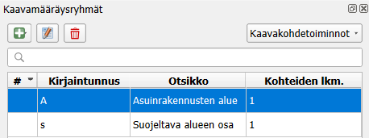
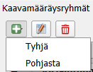
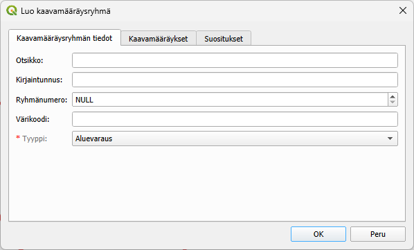
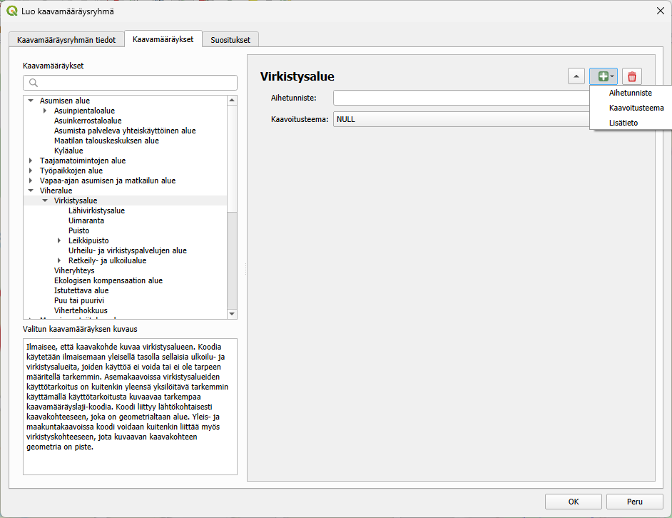
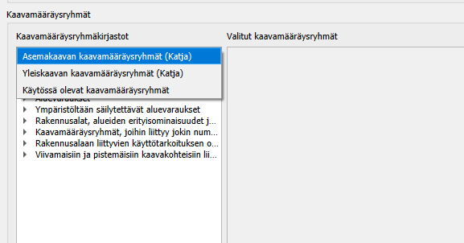
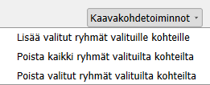
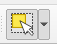
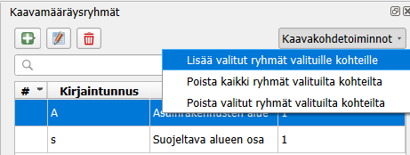
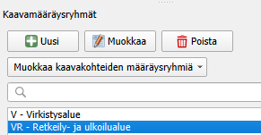
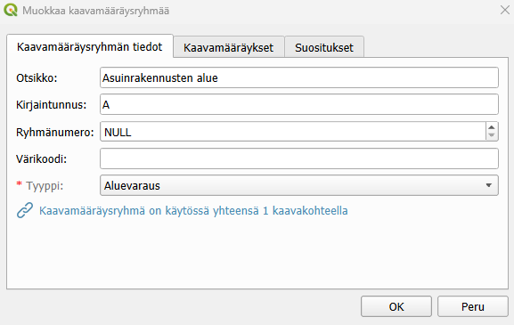

# Kaavamääräysryhmät

## Kaavamääräysryhmäpaneeli

Kaavamääräysryhmiä hallinnoidaan **Kaavamääräysryhmät**-painikkeella. Painike avaa paneelin, jossa on listattuna käytössä olevat kaavamääräysryhmät tai kaavamääräysryhmät, jotka käyttäjä on itse luonut. Lisäksi tällä työkalulla voi muokata kerralla kaavakohteiden määräysryhmiä usealle kohteelle samanaikaisesti.

1.  Uusi kaavamääräysryhmä **luodaan** kaavamääräysryhmäpaneelin { .icon } -painikkeella.

2.  Valitsemalla listalta jonkin olemassa olevan kaavamääräysryhmän aktiiviseksi (rivi muuttuu siniseksi) ja painamalla ***Muokkaa*** pääset muokkaamaan kaavamääräyksiä, tai painamalla ***Poista*** saat poistettua sen.

3.  Kaavakohdetoiminnot ovat massatoimintoja, joiden avulla voit käsitellä samalla useita kaavakohteita ja kaavamääräysryhmiä.

    

## Kaavamääräysryhmän luominen ja muokkaaminen { #create-edit }

1.  Uusi kaavamääräysryhmä luodaan ***Luo kaavamääräysryhmä*** { .icon } -painikkeella. Voit valita, luotko uuden tyhjästä vai pohjasta.

    

    1.  Tyhjästä aloittamalla pääset rakentamaan kaavamääräysryhmän alusta asti itse.

    2.  Pohjaksi voit valita esimerkiksi jonkun Katja-asetuksen mukaisen määräyksen ja muokata sitä eteenpäin omaan tarpeeseesi. Valitse ensin kirjasto ja sitten pohjaksi tuleva kaavamääräysryhmä.

    3.  Molemmilla tavoilla eteesi aukeaa **Luo kaavamääräysryhmä** -ikkuna, joka on hyvin samanlainen kuin seuraavaksi esiteltävä **Muokkaa kaavamääräysryhmää** -ikkuna.

2.  **Kaavamääräysryhmän tiedot**: On suositeltavaa antaa otsikko ja kirjaintunnus. Tyyppi on pakollinen tieto.

    { width="366" }

3.  Välilehdellä **Kaavamääräykset** muodostetaan itse kaavamääräysryhmä lisäämällä määräyksiä.

    1.  Listalla näet [Kaavamääräyslaji-koodistoon](https://koodistot.suomi.fi/codescheme;registryCode=rytj;schemeCode=RY_Kaavamaarayslaji) kuuluvat määräykset.

    2.  Valitsemalla määräyslajin näet sen kuvauksen.

    3.  Voit hakea määräyksiä hakukentän avulla tai selaamalla listaa.

    4.  Kun löydät tarvittavan määräyksen, ***kaksoisklikkaa*** sitä, jolloin määräys siirtyy oikealla olevaan laatikkoon ja pääset antamaan sille esim. aihetunnisteen, kaavoitusteeman jne.

    { width="599" }

4.  **Suositukset**-välilehdellä voit lisätä ryhmän suosituksia.

5.  ***Muokkaa valittua kaavamääräysryhmää*** { .icon } -työkalulla aukeaa kaavamääräysryhmäpaneelista siniseksi valitun kaavamääräysryhmän ikkuna, jossa pääset muokkaamaan ryhmää. **Muokkaa kaavamääräysryhmää** -ikkuna on hyvin samanlainen kuin **Luo kaavamääräysryhmä**.

    1.  ***Kaavamääräysryhmän tiedot*** -välilehdellä pääset antamaan ryhmälle perustietoja ja määrittämään tyypin (aluevaraus, osa-alue jne.).

        Huomaa sininen teksti, joka kertoo, kuinka monella kohteella ryhmä on käytössä. Jos sama kaavamääräysryhmä on liitetty moneen kaavakohteeseen, on hyvä harkita, haluaako ryhmää muokata, sillä se vaikuttaa silloin kaikkiin kohteisiin.

    2.  Välilehdellä ***Kaavamääräykset*** pääset lisäämään ryhmään kaavamääräyksiä.

6.  Kun olet luonut haluamasi ryhmän tai tehnyt muutokset olemassa olevaan, paina **OK**.

7.  Uusi ryhmä siirtyy ***Käytössä oleviin kaavamääräysryhmiin***, ja voit käyttää sitä uusille ja olemassa oleville kaavakohteille.

    { width="438" }

    Kaavakohteen piirtämisen jälkeen aukeavassa ikkunassa yksi tarjolla oleva kirjasto on **Käytössä olevat kaavamääräysryhmät**.

## Kaavamääräysryhmien kaavakohdetoiminnot

Kaavakohdepaneelista pääset hallitsemaan kaavamääräysryhmien liittymistä kaavakohteille. Voit lisätä ja poistaa valitsemiasi kaavamääräysryhmiä valitsemillesi kaavakohteille. Kaikki nämä toiminnot edellyttävät, että valitset ensin kartalta ne kaavakohteet, joiden kaavamääräysryhmiin haluat vaikuttaa.

1.  **Lisää valitut ryhmät valituille kohteille**

    1.  Valitse kartalta QGISin perusvalintatyökalulla { .icon } kohteet, joille haluat lisätä yhden tai useamman kaavamääräysryhmän.

    2.  Valitse tämän jälkeen listalta kaavamääräysryhmä (tai ryhmiä), jonka haluat lisätä kohteille (ryhmä muuttuu siniseksi), ja valitse viimeiseksi ***Kaavakohdetoiminnot > Lisää valitut ryhmät valituille kohteille***.

        { width="354" }

2.  **Poista kaikki ryhmät valituilta kohteilta**

    1.  Valitse kartalta QGISin perusvalintatyökalulla { .icon } kohteet, joilta haluat poistaa kaavamääräysryhmiä.

    2.  Valitse ***Kaavakohdetoiminnot > Poista kaikki ryhmät***.

3.  **Poista valitut ryhmät valituilta kohteilta**

    1.  Valitse kartalta QGISin perusvalintatyökalulla { .icon } kohteet, joilta haluat poistaa ryhmiä.

    2.  Valitse listalta ryhmä, jonka haluat poistaa kohteilta.

        

    3.  Valitse ***Kaavakohdetoiminnot > Poista valitut ryhmät valituilta kohteilta***.

## Vinkkejä kaavamääräysryhmien soveltamiseen

**Kaavamääräysryhmän tiedot** -välilehti:

Otsikon ja kirjaintunnuksen suositellaan olevan Katja-asetuksen mukaisia, mikäli Katjasta löytyy samanlainen kaavamääräysryhmä. Jos määräyksissä on pieniä eroja, voi kirjaintunnukseen lisätä indeksin (A-1 ja A-2).

Sininen teksti kertoo, kuinka monelle kohteelle kaavamääräysryhmä on liitetty kaavasuunnitelmassa.

Värikoodi-arvoa on mahdollista käyttää pienimuotoiseen visualisointien räätälöintiin.
