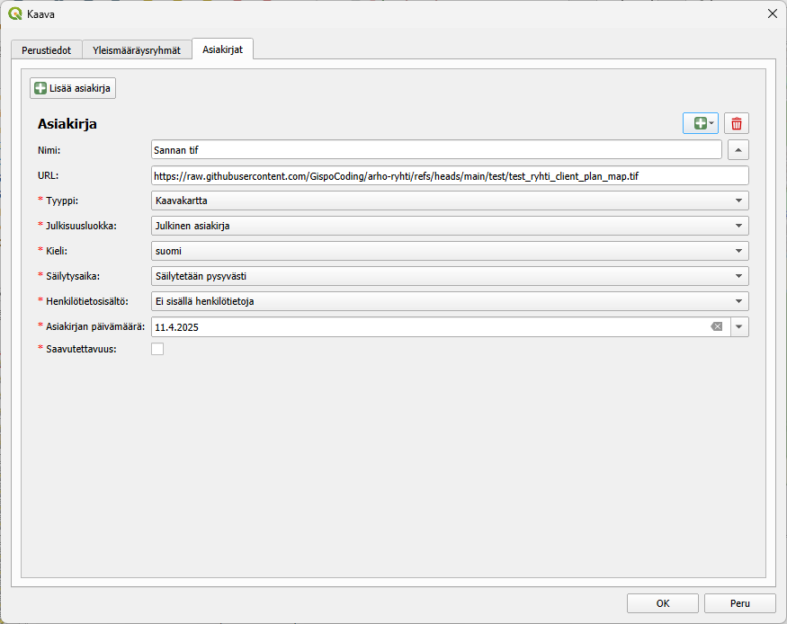
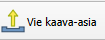
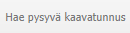
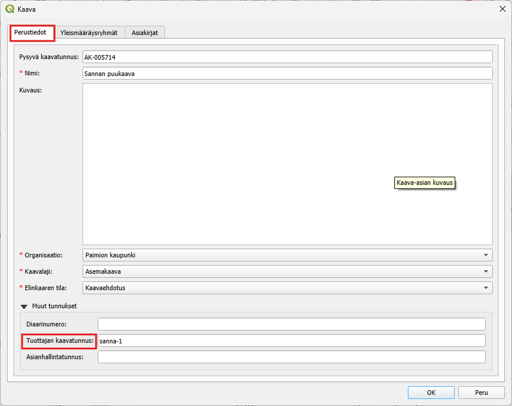

# Palveluväylää edellyttävät toiminnot

## Kaava-asian validointi

Kaava-asian voit validoida, mikäli palveluväylä on käytössä. Varmista, että olet liittänyt kaava-asialle vaaditut liitteet kaavan asiakirjojen kautta. Valitse **Validointi > Validoi kaava-asia**.

{ width="470" }

## Lähetä kaava-asia Ryhtiin

!!! note "Huomaa"

    Tämä toiminnallisuus ei tällä hetkellä ole Arhossa käytössä.

Kun haluat viedä kaava-asian Ryhtiin palveluväylää pitkin, paina { .icon }. Ennen kuin voit viedä kaava-asian Ryhtiin, hae pysyvä kaavatunnus.

## Hae pysyvä kaavatunnus

!!! note "Huomaa"

    Tämä toiminnallisuus ei tällä hetkellä ole Arhossa käytössä.

Kun haluat hakea pysyvän kaavatunnuksen, paina { .icon }.

Ryhti ei anna pysyvää kaavatunnusta, mikäli kaavalla ei ole tuottajan kaavatunnusta. Varmista kaavan perustiedoista, että olet antanut tuottajan kaavatunnuksen.

