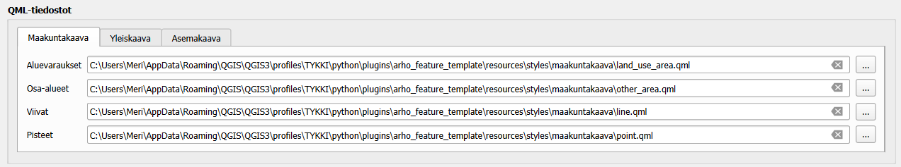

# Arhon mukana tulevat visualisoinnit

Arho tallentaa visualisoinnit sisältävät QML-tiedostot lisäosan tietoihin käyttäjän QGIS-profiilin kansioon, kun lisäosa asennetaan tai päivitetään. Tämä on yksi syy siihen, miksi Arhon käyttöä varten suositellaan luomaan erillinen QGIS-profiili.

Asetuksista on mahdollista katsoa tuo sijainti ja vaihtaa Arho käyttämään jotain muuta QML-tiedostoa kaavojen visualisoinnissa kullekin kaavatasolle erikseen. Mikäli vaihdat tiedostot, käynnistä QGIS uudelleen, jotta saat muutokset voimaan.

Huomaa, että Arho-lisäosa päivittää oletustyylien tiedostot jokaisen lisäosapäivityksen yhteydessä.
