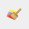
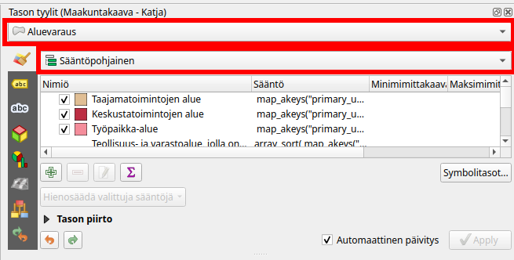
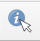
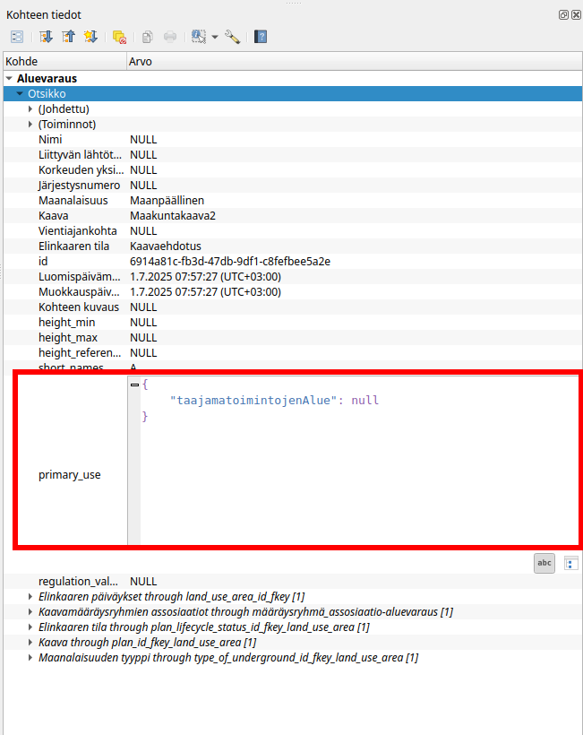
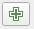
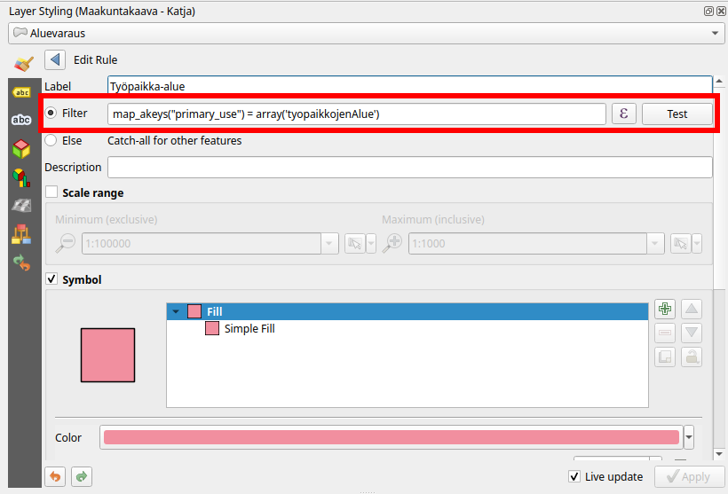

# Sääntöpohjaisen visualisoinnin tekeminen QGISissä

Jos käyttäjä haluaa tehdä omia visualisointeja, tulee niille luoda omat erilliset QML-tiedostot. Jos käyttäjä vain muokkaa Arhon oletustyylejä, muutokset tulevat ylikirjoitetuiksi seuraavan lisäosapäivityksen yhteydessä.

Sääntöpohjaiset visualisoinnit voidaan luoda kaavakohteille seuraavasti:

1.  Avaa **Tason tyylit** -paneeli { .icon } -painikkeella (tai **Näytä > Paneelit > Tason tyylit**).

2.  Valitse tyyliteltävä taso alasvetovalikosta.

3.  Valitse välilehdeltä **Kuvaustekniikka** alasvetovalikosta **Sääntöpohjainen**.

    

4.  Valitse tai digitoi tyyliteltävä kaavakohde ja lisää sille sopiva kaavamääräysryhmä.

5.  Tarkastele tyyliteltävän kohteen tietoja käyttäen **Näytä kohteen tiedot** -työkalua { .icon }.

6.  Kohteen tiedoista löytyy kenttä `primary_use` (aluevaraus), `sub_area` (osa-alueet), `type_regulations` (pisteet ja viivat) tai `regulation_values` (osa-alueet, pisteet). Tämän kentän sisältämän JSONin avulla voidaan luoda kohteen kaavamääräysryhmän yksilöivä suodatin. Joissain tapauksissa kohteen tiedot voivat sisältää useamman kentän (osa-alueet). Katso ohjeet suodattimien luomiseen kohdasta [Suodattimet](filters.md).

    { width="526" }

7.  Lisää uusi sääntö { .icon } -painikkeella (myös aiemman säännön kopiointi ja liittäminen on mahdollista).

8.  Anna säännölle nimiö (katso [Nimiöt](symbols-labels.md#labels)) ja lisää suodatin (katso [Suodattimet](filters.md)). **Testi**-painikkeella voit kokeilla, kuinka monta kohdetta suodatin palauttaa.

    

9.  Muokkaa symbolia ja sen väriä haluamallasi tavalla.
