# Symbolit ja nimiöt sekä niiden tallennus

## Symbolit

Kuvaustekniikkaa ja symboleja voidaan muokata **Tason tyylit** -paneelin ensimmäiseltä välilehdeltä. Ensin luodaan uusi sääntö edellä kuvatulla tavalla tai valitaan jokin aiemmin luoduista. Tämän jälkeen symbolia voidaan muokata paneelin alaosassa (katso kuva alla). Uusia symboleja voidaan lisätä { .icon } -painikkeella. Alla olevassa esimerkissä on luotu nelikulmainen symboli, jolla on läpinäkyvä täyttöväri, ulkorajan (viiva/stroke) väri on R 182, G 77, B 81 ja paksuus 3 pistettä. Viivan tyyli on kiinteä.

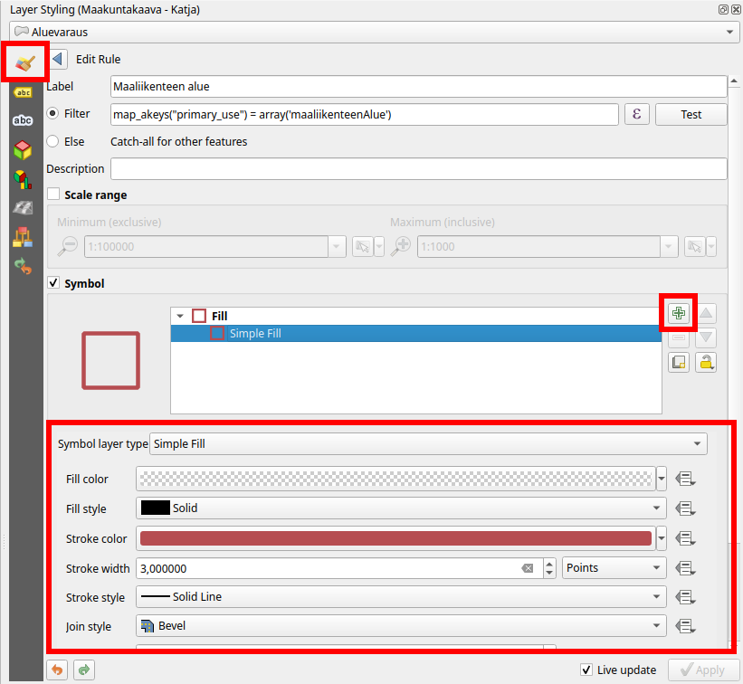

Usein luotava symboli on monimutkaisempi ja vaatii useita päällekkäisiä symboleja. Seuraavassa esimerkissä on luotu symboli kuvaamaan rautatietä. Se koostuu kahdesta päällekkäisestä symbolista. Ensin on luotu 2 pistettä paksu musta vaakasuora viiva, jonka alla on pystysuoria viivoja, joista jokaisen paksuus on 1,5 pistettä ja niiden välinen etäisyys on 5 pistettä. Pystyviivojen pituus on 3 millimetriä.

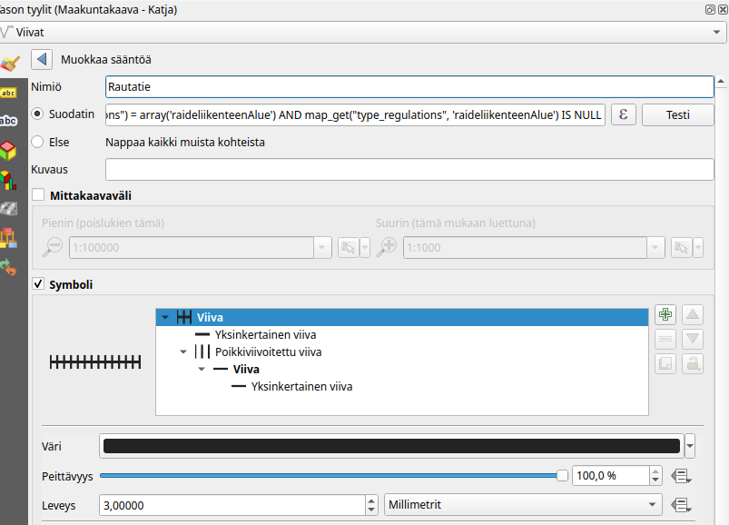

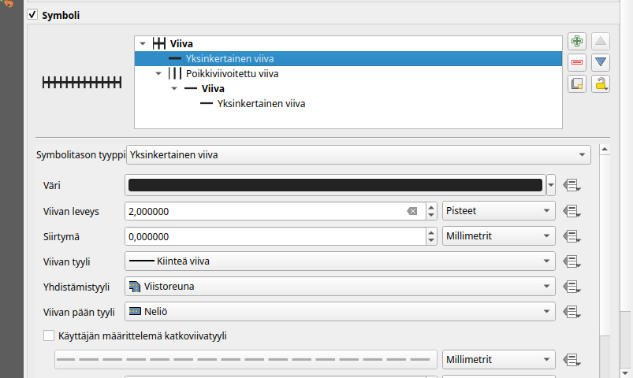

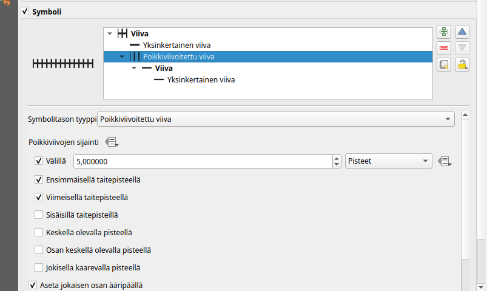

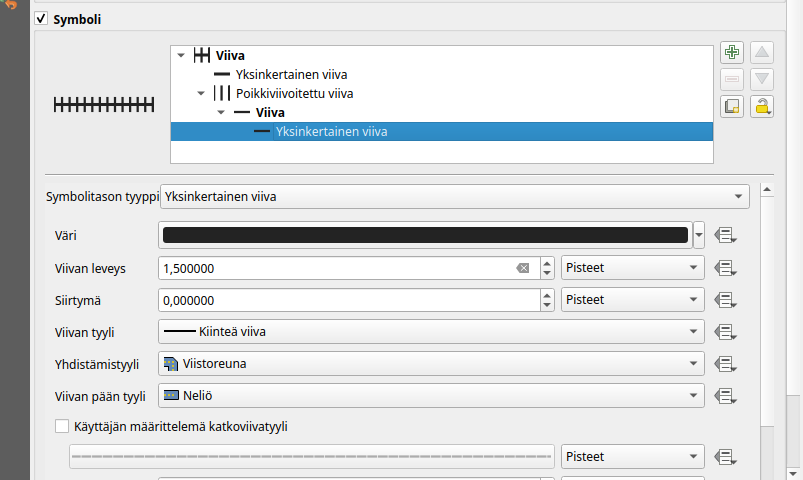

Sääntöjä, symboleja ja niiden värejä on mahdollista kopioida, mikä helpottaa uusien symbolien luomista. Sääntöjen ja symbolien kopioiminen onnistuu hiiren oikealla painikkeella.

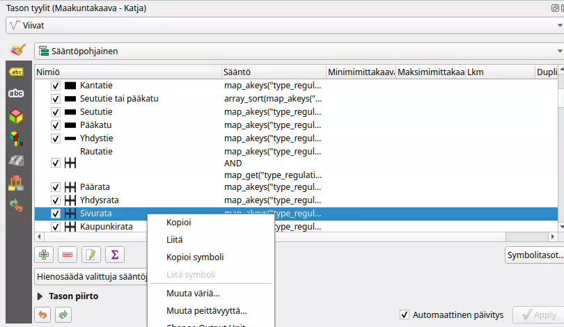

Symbolin väri on mahdollista kopioida (ja liittää) alla olevan kuvan osoittamalla tavalla.

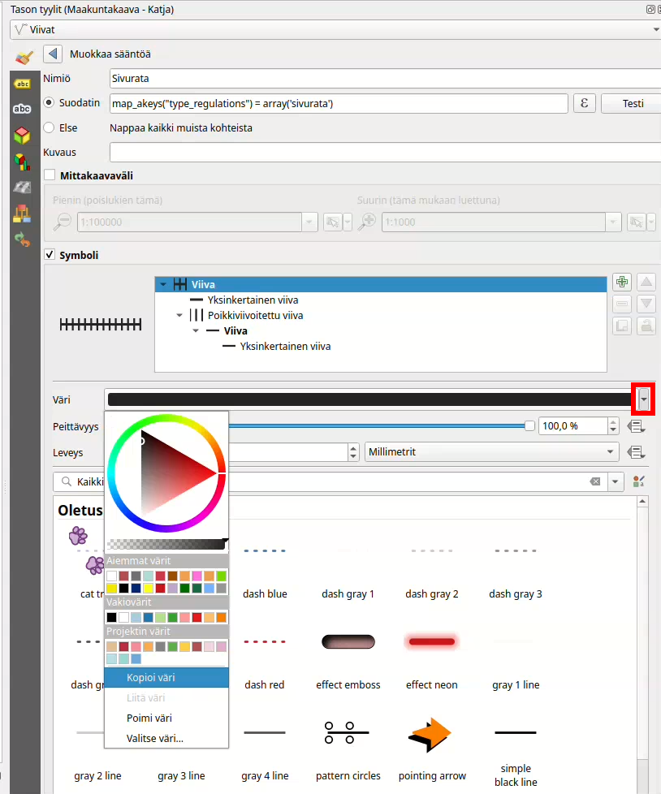

## Nimiöt { #labels }

Nimiöitä voidaan muokata **Tason tyylit** -paneelin toiselta välilehdeltä. Eri symboleille saattaa olla tarpeellista asettaa erikokoisia nimiöitä. Tämä voidaan saavuttaa luomalla sääntöpohjainen nimiöinti. Mikäli erikokoisille tai -värisille fonteille ei ole tarvetta, yksinkertainen nimiöinti riittää.

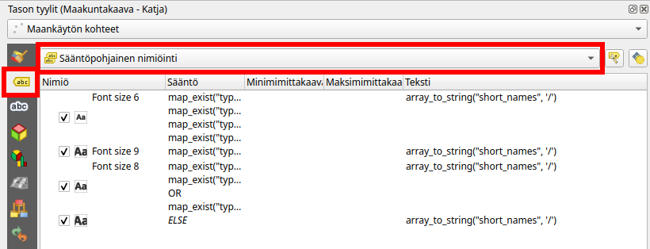

Uuden säännön voi lisätä { .icon } -painikkeella. Lisää säännölle yksilöivä kuvaus (esim. ”Fonttikoko 6”). Kuten symbolien tapauksessa, myös sääntöpohjaiset nimiöt tarvitsevat suodattimia (katso [Suodattimet](filters.md)). Suodattimen asettamisen jälkeen varmistetaan, että nimiöt ovat käytössä kyseiselle säännölle (valintaruutu). Lisäksi laitetaan kohtaan **Arvo** lauseke `array_to_string("short_names", '/')`. Tämän jälkeen voidaan muokata itse nimiötä: paneelin alaosassa ovat välilehdet tekstin muotoilua ja sijoittamista sekä vyöhykkeen, maskin, taustan ym. luomista varten.

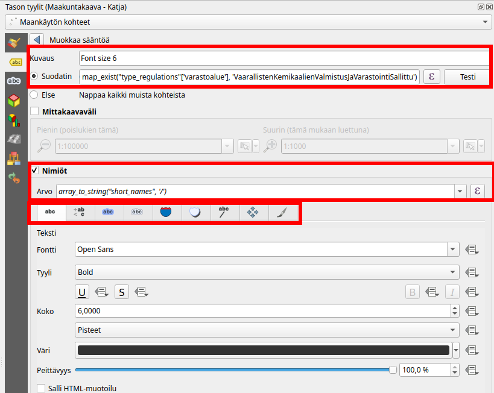

Monikulmiokohteiden nimiöinnissä on hyvä laittaa **Sijoittaminen**-välilehdeltä päälle asetus **Pakota piste monikulmion sisään**, jotta nimiö ei joissakin tapauksissa ilmesty monikulmion ulkopuolelle.

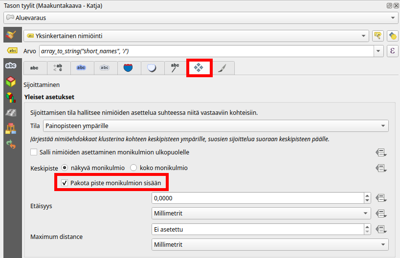

## Symbolien ja nimiöiden tallentaminen { #save }

Tasojen tyylit tallentuvat QGIS-projektitiedostoon (++ctrl+s++ tai **Projekti > Tallenna**). Jotta kuvaustekniikat olisivat käytettävissä sekä muille käyttäjille että projektitiedoston päivittämisen jälkeen, kannattaa tyylit tallentaa QML-tiedostoihin. Huomaa, että jokaiselle tasolle tulee luoda oma QML-tiedosto.

!!! warning "Huom."

    Saman tai uuden kaavan avaaminen aiheuttaa tyylien uudelleen lataamisen QML-tiedostoista, mikä johtaa projektiin tallennettujen tyylien ylikirjoittamiseen. Tämän vuoksi on suositeltavaa tallentaa uusia tyylejä tiedostoihin sitä mukaa kuin niitä tekee.

Tallentaminen onnistuu **Tyylien hallinta** -välilehdeltä. Ensin valitaan oikea taso alasvetovalikosta ja sitten painetaan 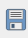{ .icon } -painiketta.

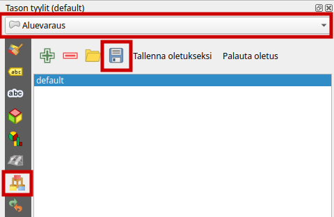{ width="395" }

**Tallenna tyyli** -painike avaa alla näkyvän ikkunan. Ensin valitaan **Tallenna tyyli** -alasvetovalikosta **QGIS QML -tyylitiedostona**. Sitten asetetaan polku tallennettavalle tiedostolle 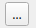{ .icon } -painikkeella. Tämän jälkeen valitaan tallennettavat luokat. Näistä riittää valita **Kuvaustekniikka** ja **Nimiöt**. Lopuksi painetaan **OK**.

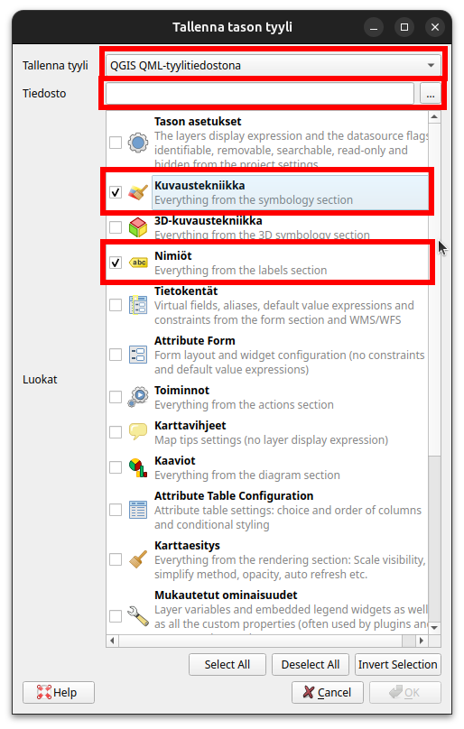{ width="283" }

QML-tiedostoon tallennettu tyyli voidaan ottaa käyttöön { .icon } -painikkeella. Ensin valitaan alasvetovalikosta **From file** ja asetetaan QML-tiedoston tallennuspolku { .icon } -painikkeella. Jälleen riittää valita luokiksi **Kuvaustekniikka** ja **Nimiöt**. Tämän jälkeen painetaan **Lataa tyyli**.

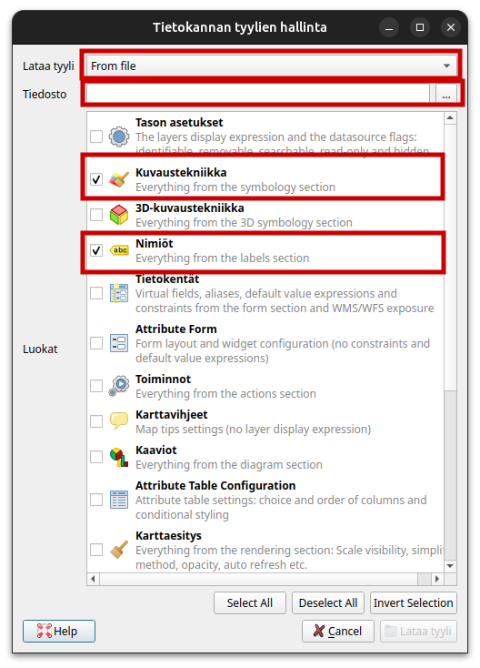{ width="283" }

## QML-tiedostojen yhdistäminen

Kahden (tai useamman) QML-tyylitiedoston sääntöpohjaiset kuvaustekniikat ja nimiöt voidaan yhdistää helpoiten seuraavasti: ladataan ensimmäisen QML-tiedoston tyylit sille tasolle, jonka tyylit halutaan yhdistää (katso [Symbolien ja nimiöiden tallentaminen](#save)).

Tämän jälkeen luodaan väliaikainen luonnostaso. 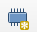{ .icon } -painike löytyy **Tietolähteiden hallinta** -työkalupalkista 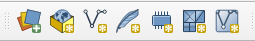{ .icon }, jonka saa näkyviin valitsemalla **Näytä > Työkalut > Tietolähteiden hallinnan työkalupalkki**. Valitaan oikea geometriatyyppi (monipiste, monimurtoviiva tai multipolygoni) ja projektin koordinaattijärjestelmä (EPSG:3067). Mitään kenttiä ei tarvitse luoda. Painetaan lopuksi **OK**.

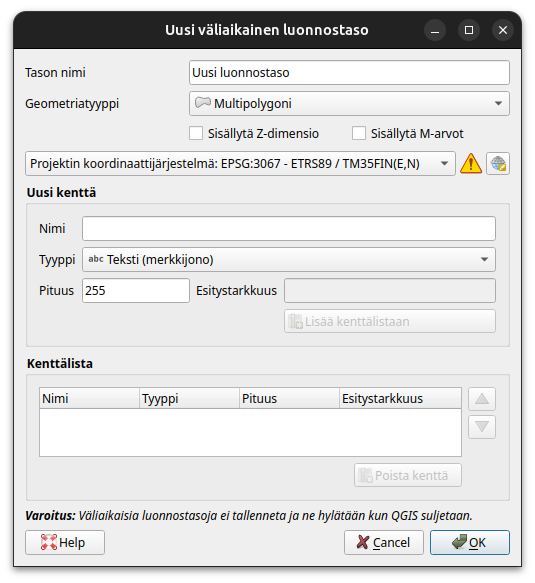

Avataan **Tason tyylit** -paneeli ja valitaan tämä juuri luotu luonnostaso alasvetolaatikosta. Sen jälkeen ladataan toisen QML-tiedoston tyylit luonnostasolle kohdassa [Symbolien ja nimiöiden tallentaminen](#save) kuvatulla tavalla.

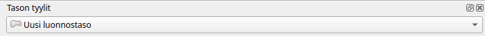

Maalataan kaikki ne säännöt, jotka halutaan kopioida, painetaan hiiren oikeaa painiketta ja valitaan **Kopioi** (++ctrl+c++ ei välttämättä toimi).

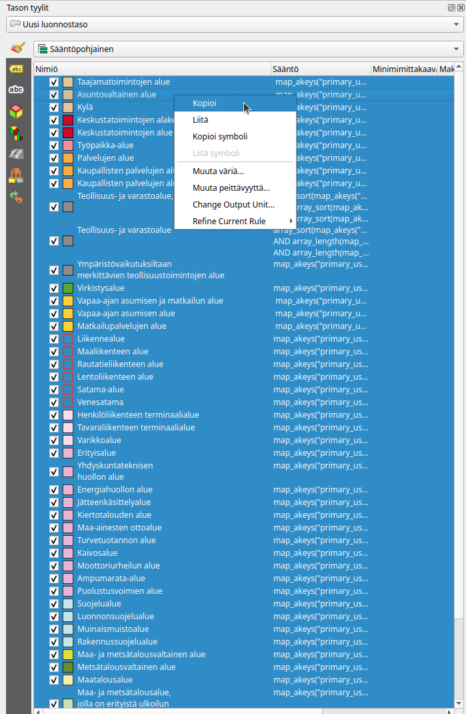

Nyt valitaan haluttu kohdetaso alasvetovalikosta, painetaan hiiren oikeaa painiketta sääntökentässä ja valitaan **Liitä**.

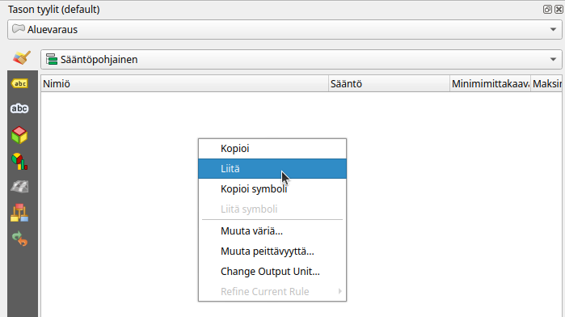

Tämä prosessi voidaan toistaa, jos halutaan yhdistää useampi kuin kaksi QML-tiedostoa. Huomaa, että väliaikaisia luonnostasoja ei ole tallennettu tiedostoon, ja ne poistuvat, kun QGIS suljetaan.
