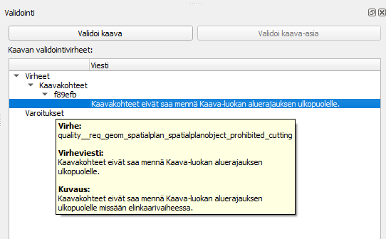

# Validointi

**Validointi**-painikkeen kautta pääset **Validointi**-paneeliin ja voit validoida kaavan painamalla ***Validoi kaavasuunnitelma***. Validointi tarkistaa, onko kaava Ryhti-kaavatietomallin määritysten mukainen. Työskentelyn kannalta voi olla järkevää validoida kaavaa melko usein, näin mahdollisten validointivirheiden jäljitys on helpointa.

Validoinnin virheviestit tulevat Syken rajapinnan kautta. Virheiden tulkinnan ja löytämisen avuksi Arhossa on joitakin toteutuksia:

- Gispo on lisännyt viestiin kuvauksen, joka löytyy Syken validointidokumentista.
- Näet virheviestin kokonaan, kun viet hiiren kursorin virheen päälle.
- Klikkaamalla kerran virheviestiä virheellinen kohde välähtää kartalla punaisella.
- Kaksoisklikkaamalla virheviestiä aukeavat kohteen tiedot, ja voit korjata virheen muokkaamalla tietoja.

Tietoa Ryhdin validointisäännöistä löytyy [Syken sivuilta](https://ryhti.syke.fi/alueidenkaytto/tietomallimuotoinen-kaavoitus/kaavasuunnitelman-validointisaannot/). Myös [Kaavatiedon-validointisaannot-ja-paluuarvot.pdf](https://ryhti.syke.fi/wp-content/uploads/sites/2/2023/11/Kaavatiedon-validointisaannot-ja-paluuarvot.pdf) -dokumenttiin kannattaa tutustua. Esimerkiksi validointivirhe `lifecycle__req_dateonly_incorrect_type, The date must be in the format yyyy-mm-dd` voi tarkoittaa myös, että jokin vaadittu päivämäärä puuttuu.
