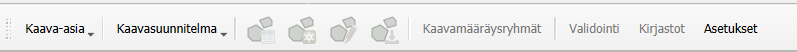
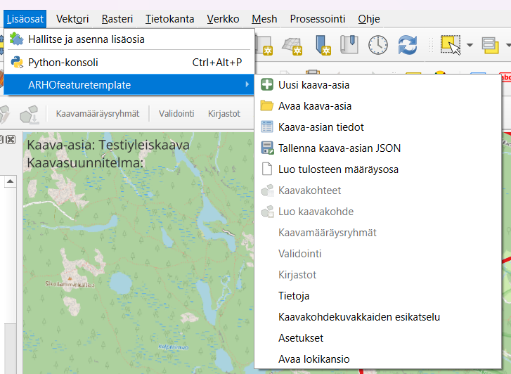
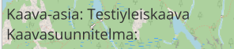

# Arhon käyttöliittymä

Arho-lisäosan mukana QGISiin tulee Arhon työkalupalkki.

Työkalut ovat harmaina, jos niitä ei sillä hetkellä voi käyttää. Esimerkiksi jos auki ei ole yhtään aktiivista kaavasuunnitelmaa, eivät myöskään kaavakohteiden ja kaavamääräysryhmien työkalut ole aktiivisina.

Tämä käyttöohje käsittelee näitä työkaluja ja niiden alta löytyviä toimintoja omissa osioissaan.

QGISin **Lisäosat**-valikon alta pääsee myös käsiksi Arhon asetuksiin ja työkaluihin.

Viimeisenä listalla oleva **Avaa lokikansio** vie käyttäjän kansioon, johon Arho tallentaa käyttäjän toimia. Tämä tiedosto on tarpeen, kun haluaa raportoida ongelman Arhossa, sillä se auttaa kehittäjiä selvittämään ongelman.

Karttaikkunaan tulee kaavoitusprojektin myötä tieto, mikä kaava-asia ja mikä kaavasuunnitelma ikkunassa on aktiivisena. Jos kohta on tyhjä, mikään ei ole aktiivisena. Esimerkiksi alla on aktiivinen kaava-asia, mutta ei yhtään aktiivista kaavasuunnitelmaa.

